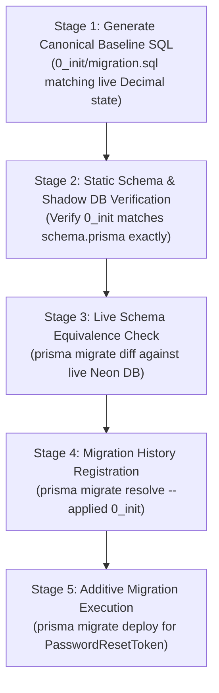

# TRUV LEDGEROS — PHASE 2F: MIGRATION BASELINE ANALYSIS AND VERIFICATION REPORT

**Date:** October 13, 2026  
**Auditor / Architect:** Antigravity Agentic Security & Database Architect  
**Status:** COMPLETE (READ-ONLY ANALYSIS & PREPARATION)  
**Target Application:** TRUV LedgerOS (`c:\Users\imris\OneDrive\Desktop\TRUVCA\TRUVCA`)  
**Target Database:** Neon Cloud Serverless PostgreSQL (`ep-square-wildflower-b5bmrz7r-pooler...`)  
**Verdict:** **NO-GO FOR DIRECT EXECUTION — BASELINE STRATEGY MANDATED**

---

## 1. Executive Summary

Phase 2F provides a comprehensive, read-only baseline analysis and verification of the database migration architecture for TRUV LedgerOS. 

Previous phases successfully remediated critical security issues in application code:
- **Phase 2A & 2B:** Identified that the live database was provisioned via `prisma db push` and uncovered severe data-loss risks associated with naive client deduplication.
- **Phase 2C & 2D:** Prepared and reviewed an isolated additive SQL migration for `PasswordResetToken` and identified concurrency race condition **SEC-01** and redundant index **SQL-02**.
- **Phase 2E:** Fully hardened `src/lib/auth/actions.ts` with an atomic conditional transaction (`updateMany` with `usedAt: null` and expiry check), pruned redundant indexes, and validated the flow across 254 test cases.

However, the repository's migration infrastructure remains in a **split-brain state**:
1. The live database currently operates **without** a `_prisma_migrations` tracking table.
2. The legacy prototype migration ([`20261006041258_phase2_auth_rbac_tenancy/migration.sql`](file:///c:/Users/imris/OneDrive/Desktop/TRUVCA/TRUVCA/prisma/migrations/20261006041258_phase2_auth_rbac_tenancy/migration.sql)) uses obsolete floating-point types (`DOUBLE PRECISION` across 17 monetary/numeric columns) and **completely omits** the `Session` model.
3. Blindly executing `prisma migrate deploy` or resolving the legacy prototype migration as applied will either fail immediately (`relation "Tenant" already exists`) or cause permanent drift on Prisma's shadow database during subsequent development cycles.
4. Concurrency testing in `tests/password-reset-concurrency.test.ts` was implemented using an in-memory transactional mock harness. While it proves application-level control flow, real PostgreSQL lock queuing and connection-pooler dynamics remain unverified on live infrastructure.

This report establishes the verified inventory of all migration files, analyzes schema differences, formulates a safe baselining procedure, evaluates concurrency test limitations, details backup verification prerequisites, and delivers an authoritative **GO/NO-GO** decision.

---

## 2. Severity-Classified Findings Matrix

| Finding ID | Title | Severity | Impacted Area | Description & Operational Risk |
|---|---|:---:|---|---|
| **MIG-01** | Legacy Prototype Migration Type Drift & Schema Incompleteness | **HIGH** | `prisma/migrations/` | `20261006041258` defines all monetary columns as `DOUBLE PRECISION` and omits `Session`. Baselining against this file causes fatal shadow database drift during `prisma migrate dev`. |
| **MIG-02** | Absence of Migration Tracking History in Live Database | **HIGH** | Neon Database / `_prisma_migrations` | The live database was provisioned via `prisma db push`. `_prisma_migrations` does not exist. Running `prisma migrate deploy` naively will abort with `relation already exists`. |
| **OPS-01** | Absence of Verified Database Backup and Tested Restore Point | **HIGH** | Operational Continuity | No cold archive, `.dump` file, or verified Neon branch snapshot exists. Schema alterations without tested restorability violate production safety boundaries. |
| **TST-01** | Concurrency Test Relies on In-Memory Mock Transaction Harness | **MEDIUM** | `tests/password-reset-concurrency.test.ts` | The test validates application-layer logic but does not verify actual PostgreSQL engine row-level locks, isolation level semantics, or connection pooler multiplexing. |
| **SEC-03** | Outstanding Sibling Reset Tokens Not Bulk-Revoked on Redemption | **LOW** | `src/lib/auth/actions.ts` | When a user requests multiple reset links, redeeming one token invalidates only that specific token; prior unexpired tokens remain valid until their 1-hour expiry. |
| **CLI-01** | Windows File Lock Prevents Native Engine Regeneration | **LOW** | `@prisma/client` | Active Next.js development server process locks `query_engine-windows.dll.node`, causing `EPERM` during `prisma generate`. |

---

## 3. Migration Files Inventory & Checksums

Static inspection of `prisma/migrations/` and `prisma/proposed_migrations/` reveals the following artifacts:

### 3.1 Inventory Table

| Relative File Path | Size (Bytes) | SHA-256 Checksum | Operations Defined | Status |
|---|:---:|---|---|---|
| `prisma/migrations/migration_lock.toml` | 126 | `d9e03d92b34360e227bbfa0f3ec52f75a6435c24d9c79f323862660d5b6f7e80` | Specifies provider: `"postgresql"` | Active in Git |
| `prisma/migrations/20261006041258_phase2_auth_rbac_tenancy/migration.sql` | 26,845 | `6b172c8c9d1f5d7574da8b66e98dd106d6ed13353be6371a7ce27feee07334de` | Creates 12 Enums, 24 Tables, 46 Indexes, 33 Foreign Keys | **Legacy Draft (Unapplied)** |
| `prisma/proposed_migrations/20261013_phase2a_security_schema_sync.sql` | 6,323 | `7b0e317cbbc0a5cfba41839727bc058c167b54c6138e87dcebf9d2cd9a428163` | Creates `PasswordResetToken`; attempts naive client deduplication | **REJECTED (NO-GO in Phase 2B)** |
| `prisma/proposed_migrations/20261013_phase2c_add_password_reset_token.sql` | 1,987 | `47e259abb6bf48bb2e78153dd7423a20ad7faa8a97fabdabcbfe85eadcb707d1` | Creates `PasswordResetToken` table, unique index, foreign key, index | **Verified Additive Draft (Pruned)** |

### 3.2 Operation Details of Legacy Migration `20261006041258`
- **Enums Created (12):** `Role`, `InvoiceStatus`, `PaymentRecoveryStage`, `GstReturnType`, `GstReturnStatus`, `DocumentStatus`, `CommunicationChannel`, `CommunicationDirection`, `TaskType`, `TaskStatus`, `EventStatus`, `SubscriptionTier`.
- **Tables Created (24):** `Tenant`, `User`, `Membership`, `Client`, `Contact`, `Invoice`, `InvoiceItem`, `Payment`, `GstProfile`, `GstReturn`, `DocumentRequest`, `Document`, `Task`, `Communication`, `Conversation`, `Message`, `KnowledgeBase`, `Automation`, `AutomationRun`, `AutomationEvent`, `Subscription`, `UsageRecord`, `Integration`, `AuditLog`, `Notification`.
- **Missing Models (2):** `Session` is completely absent. `PasswordResetToken` is completely absent.

---

## 4. Deep Schema Comparison: Legacy Migration vs. `prisma/schema.prisma`

A line-by-line comparative audit between [`20261006041258_phase2_auth_rbac_tenancy/migration.sql`](file:///c:/Users/imris/OneDrive/Desktop/TRUVCA/TRUVCA/prisma/migrations/20261006041258_phase2_auth_rbac_tenancy/migration.sql) and [`prisma/schema.prisma`](file:///c:/Users/imris/OneDrive/Desktop/TRUVCA/TRUVCA/prisma/schema.prisma) identified substantial divergence:

### 4.1 Monetary and Numeric Column Types

In financial and statutory accounting software, binary floating-point types (`DOUBLE PRECISION` / IEEE 754) introduce rounding errors (e.g., `0.1 + 0.2 = 0.30000000000000004`). The current `prisma/schema.prisma` and the live Neon database correctly use arbitrary-precision decimals (`Decimal(12, 2)`). However, the legacy migration defines all monetary columns as `DOUBLE PRECISION`:

| Table | Column Name | Legacy Migration (`20261006041258`) | `prisma/schema.prisma` | Live Neon DB State | Impact / Risk |
|---|---|---|---|---|---|
| `Tenant` | `approvalThreshold` | `DOUBLE PRECISION NOT NULL DEFAULT 50000.00` | `Decimal @default(50000.00) @db.Decimal(12, 2)` | `numeric(12, 2)` | Shadow DB Type Conflict |
| `Tenant` | `defaultGstRate` | `DOUBLE PRECISION NOT NULL DEFAULT 18.00` | `Decimal @default(18.00) @db.Decimal(5, 2)` | `numeric(5, 2)` | Shadow DB Type Conflict |
| `Client` | `monthlyFee` | `DOUBLE PRECISION NOT NULL DEFAULT 0` | `Decimal @default(0.00) @db.Decimal(12, 2)` | `numeric(12, 2)` | Shadow DB Type Conflict |
| `Invoice` | `subtotal` | `DOUBLE PRECISION NOT NULL` | `Decimal @db.Decimal(12, 2)` | `numeric(12, 2)` | Shadow DB Type Conflict |
| `Invoice` | `gstRate` | `DOUBLE PRECISION NOT NULL DEFAULT 18.0` | `Decimal @default(18.00) @db.Decimal(5, 2)` | `numeric(5, 2)` | Shadow DB Type Conflict |
| `Invoice` | `cgstAmount` | `DOUBLE PRECISION NOT NULL DEFAULT 0` | `Decimal @default(0.00) @db.Decimal(12, 2)` | `numeric(12, 2)` | Shadow DB Type Conflict |
| `Invoice` | `sgstAmount` | `DOUBLE PRECISION NOT NULL DEFAULT 0` | `Decimal @default(0.00) @db.Decimal(12, 2)` | `numeric(12, 2)` | Shadow DB Type Conflict |
| `Invoice` | `igstAmount` | `DOUBLE PRECISION NOT NULL DEFAULT 0` | `Decimal @default(0.00) @db.Decimal(12, 2)` | `numeric(12, 2)` | Shadow DB Type Conflict |
| `Invoice` | `totalAmount` | `DOUBLE PRECISION NOT NULL` | `Decimal @db.Decimal(12, 2)` | `numeric(12, 2)` | Shadow DB Type Conflict |
| `InvoiceItem` | `quantity` | `DOUBLE PRECISION NOT NULL DEFAULT 1` | `Decimal @default(1.00) @db.Decimal(10, 2)` | `numeric(10, 2)` | Shadow DB Type Conflict |
| `InvoiceItem` | `unitPrice` | `DOUBLE PRECISION NOT NULL` | `Decimal @db.Decimal(12, 2)` | `numeric(12, 2)` | Shadow DB Type Conflict |
| `InvoiceItem` | `total` | `DOUBLE PRECISION NOT NULL` | `Decimal @db.Decimal(12, 2)` | `numeric(12, 2)` | Shadow DB Type Conflict |
| `Payment` | `amount` | `DOUBLE PRECISION NOT NULL` | `Decimal @db.Decimal(12, 2)` | `numeric(12, 2)` | Shadow DB Type Conflict |
| `GstReturn` | `outputTax` | `DOUBLE PRECISION NOT NULL DEFAULT 0` | `Decimal @default(0.00) @db.Decimal(12, 2)` | `numeric(12, 2)` | Shadow DB Type Conflict |
| `GstReturn` | `inputTaxCredit` | `DOUBLE PRECISION NOT NULL DEFAULT 0` | `Decimal @default(0.00) @db.Decimal(12, 2)` | `numeric(12, 2)` | Shadow DB Type Conflict |
| `GstReturn` | `netPayable` | `DOUBLE PRECISION NOT NULL DEFAULT 0` | `Decimal @default(0.00) @db.Decimal(12, 2)` | `numeric(12, 2)` | Shadow DB Type Conflict |
| `UsageRecord` | `quantity` | `DOUBLE PRECISION NOT NULL DEFAULT 1` | `Decimal @default(1.00) @db.Decimal(10, 2)` | `numeric(10, 2)` | Shadow DB Type Conflict |

### 4.2 Missing Models and Relationships
1. **The `Session` Model:**
   - **Legacy Migration:** Does not create table `"Session"`. Contains 0 references to sessions.
   - **Prisma Schema:** Declares `model Session` with `sessionToken String @unique`, foreign keys to `User` and `Tenant`, and 3 indexes.
   - **Live Neon Database:** Table `"Session"` **exists** (provisioned via `prisma db push`).
2. **The `PasswordResetToken` Model:**
   - **Legacy Migration:** Does not create table `"PasswordResetToken"`.
   - **Prisma Schema:** Declares `model PasswordResetToken` with `tokenHash String @unique`, `userId` foreign key, and `@@index([userId])`.
   - **Live Neon Database:** Table `"PasswordResetToken"` **does not exist**.
3. **Foreign Keys & Cascading Deletes:**
   - Legacy migration defines 33 foreign keys.
   - Missing foreign keys in legacy migration:
     - `"Session_userId_fkey"` (references `User(id)` ON DELETE CASCADE)
     - `"Session_tenantId_fkey"` (references `Tenant(id)` ON DELETE CASCADE)
     - `"PasswordResetToken_userId_fkey"` (references `User(id)` ON DELETE CASCADE)

---

## 5. Why the Live Database Was Provisioned with `prisma db push` and Why Blind Deployment Fails

### 5.1 Root Cause of `prisma db push` Provisioning
During the initial prototyping phase of LedgerOS, developers utilized `prisma db push` to synchronize rapid schema changes directly against Neon.
- `prisma db push` synchronizes the schema state directly against the database engine without creating SQL migration files or populating the internal `_prisma_migrations` table.
- Over successive iterations, developers converted monetary fields from floats to `Decimal(12, 2)` and added the `Session` model. Because these were pushed directly, the live database evolved past the legacy draft migration in `prisma/migrations/`.

### 5.2 Failure Modes of Naive Migration Commands

#### Failure Mode 1: Executing `prisma migrate deploy`
- `prisma migrate deploy` inspects the live database for `_prisma_migrations`.
- Because `_prisma_migrations` does not exist, Prisma assumes the database is uninitialized and begins executing migrations in alphabetical order.
- The first file encountered is `20261006041258_phase2_auth_rbac_tenancy/migration.sql`.
- Execution immediately crashes on:
  ```sql
  CREATE TYPE "Role" AS ENUM (...);
  -- or
  CREATE TABLE "Tenant" (...);
  ```
- **Error:** `ERROR: relation "Tenant" already exists` or `type "Role" already exists`.
- **Consequence:** Deployment fails; process aborts; CI/CD pipeline breaks.

#### Failure Mode 2: Resolving the Legacy Migration via `prisma migrate resolve --applied`
If an operator executes `npx prisma migrate resolve --applied 20261006041258_phase2_auth_rbac_tenancy`:
1. Prisma records `20261006041258` as applied in `_prisma_migrations`.
2. When any developer runs `npx prisma migrate dev` in the future, Prisma creates a temporary **shadow database** and replays all recorded migrations from `prisma/migrations/`.
3. The shadow database is populated with `DOUBLE PRECISION` columns and lacks the `Session` table.
4. Prisma compares the shadow database against `prisma/schema.prisma` (which has `Decimal(12,2)` and `Session`).
5. Prisma detects massive divergence and throws an error:
   ```
   Drift detected: Your database schema does not match your migration history.
   We need to alter 17 columns from DOUBLE PRECISION to DECIMAL and create table "Session"...
   ```
6. Prisma will prompt to **reset the database** (dropping all data) or generate a destructive alter-column migration.

---

## 6. End-to-End Safe Baseline Architecture

To safely transition the live Neon database from `prisma db push` to formal `prisma migrate` without data loss or shadow database drift, the process must be separated into five strictly ordered stages:



### Stage 1: Generate Canonical Baseline File (`0_init`)
1. Create a baseline migration folder: `prisma/migrations/0_init/`.
2. Generate the canonical SQL representing the exact current live schema (with `numeric(12, 2)` monetary columns and `Session`, excluding `PasswordResetToken`):
   ```bash
   # Generated via Prisma diff against datamodel (with PasswordResetToken temporarily excluded)
   npx prisma migrate diff --from-empty --to-schema-datamodel prisma/schema.prisma --script > prisma/migrations/0_init/migration.sql
   ```
3. Archive or remove the obsolete `20261006041258_phase2_auth_rbac_tenancy` directory so it is never replayed.

### Stage 2: Validate Against Intended Schema
1. Perform static analysis on `0_init/migration.sql` to confirm:
   - All 17 monetary fields use `DECIMAL(12, 2)`, `DECIMAL(5, 2)`, or `DECIMAL(10, 2)`.
   - Table `"Session"` is created with unique constraints and foreign keys.
   - Table `"PasswordResetToken"` is omitted from the baseline (reserved for the additive migration).
2. Validate against a shadow database to confirm that replaying `0_init/migration.sql` creates a schema identical to `schema.prisma`.

### Stage 3: Verify Actual Live Schema Equivalence
Before registering the baseline, run a non-destructive schema diff between the live Neon database and the baseline model:
```bash
npx prisma migrate diff --from-url "$DATABASE_URL" --to-migrations prisma/migrations --exit-code
```
- Expected result: The diff must report that the only discrepancy is the absence of `_prisma_migrations` and `PasswordResetToken`.
- If any existing table or column diverges, halt immediately.

### Stage 4: Register Migration History Without Replaying DDL
Because all tables in `0_init` already exist in the live database, `0_init` must **never** be executed against Neon. Instead, register it as already applied:
```bash
npx prisma migrate resolve --applied 0_init
```
- This creates the `_prisma_migrations` table in Neon and records `0_init` with its checksum.
- Zero tables, columns, or rows are altered.

### Stage 5: Execute Future Additive Migrations Formally
1. Move the verified additive script into `prisma/migrations/`:
   `prisma/migrations/20261013_add_password_reset_token/migration.sql`.
2. Run standard deployment:
   ```bash
   npx prisma migrate deploy
   ```
- Prisma recognizes `0_init` as already applied.
- Prisma executes only `20261013_add_password_reset_token`, creating the `PasswordResetToken` table and recording the migration in `_prisma_migrations`.

---

## 7. Analysis of `tests/password-reset-concurrency.test.ts`

### 7.1 Test Harness Architecture
Inspection of [`tests/password-reset-concurrency.test.ts`](file:///c:/Users/imris/OneDrive/Desktop/TRUVCA/TRUVCA/tests/password-reset-concurrency.test.ts) reveals that it operates on an **in-memory mock harness** (`createHarness()`).

- **Mock Implementation:**
  - Database tables are emulated via JavaScript `Map<string, MockTokenRecord>`, `Map<string, MockUserRecord>`, and `Map<string, MockSessionRecord>`.
  - `db.$transaction` is emulated by taking shallow copy snapshots of the Maps prior to executing the callback. If the callback throws, snapshots are restored to simulate transaction rollback.
  - `updateMany` iterates through the in-memory Map, matching `rec.id === where.id && rec.usedAt === null && rec.expiresAt > where.expiresAt.gt`, updating matching entries, and returning `{ count }`.
  - The simultaneous redemption test (Test 4) executes `Promise.all([resetPasswordAction(raceFd1), resetPasswordAction(raceFd2)])`.

### 7.2 What the Test Successfully Proves
1. **Application-Layer Control Flow:** Proves that `resetPasswordAction` correctly evaluates `claimResult.count === 0` and throws `TOKEN_ALREADY_USED_OR_EXPIRED`.
2. **Error Translation & Sanitization:** Proves that a losing concurrent request catches the transaction abort and returns `{ error: "Invalid or expired password reset link." }` without exposing internal database errors.
3. **Atomic Rollback Logic:** Proves that if downstream operations (`user.update`) throw an exception, the transaction catches it and reverts changes (in the mock, `usedAt` remains `null` and user sessions remain intact).
4. **Anti-Enumeration & Validation:** Proves email anti-enumeration and password complexity rejection prior to entering database transactions.

### 7.3 What Remains Unverified (Live Engine Limitations)
1. **PostgreSQL Row-Level Locking:** The mock relies on JavaScript's single-threaded event loop. In real PostgreSQL, two concurrent worker threads execute parallel `UPDATE` statements that acquire physical `RowExclusiveLock` locks on disk pages. Real PostgreSQL row-lock contention, wait-queues, and statement timeouts are not tested by this mock.
2. **Transaction Isolation Level Differences:**
   - Under PostgreSQL's default `READ COMMITTED`, the second transaction waits for the first transaction's lock to release, then re-evaluates the `WHERE` condition on the newly committed row tuple (where `usedAt IS NOT NULL`), updating 0 rows.
   - Under `REPEATABLE READ` or `SERIALIZABLE`, PostgreSQL throws a serialization failure (`ERROR: could not serialize access due to concurrent update`, SQLSTATE 40001 / Prisma code `P2034`). The mock does not emulate SQLSTATE serialization exceptions.
3. **Connection Pooler Multiplexing:** In Neon Serverless PostgreSQL, connections pass through PgBouncer / Neon connection pooler. Interactive transactions hold dedicated connection checkouts. Connection lease timeouts, transaction limits, and pooler behavior under concurrent load remain unverified.
4. **Multi-Process / Multi-Instance Concurrency:** In a multi-node production deployment (e.g., Vercel serverless functions or container clusters), requests originate from distinct Node.js runtimes.

---

## 8. Transaction and Isolation Review of Phase 2E Implementation

A detailed review of [`resetPasswordAction`](file:///c:/Users/imris/OneDrive/Desktop/TRUVCA/TRUVCA/src/lib/auth/actions.ts) (lines 153–234) identified the following architectural characteristics:

### 8.1 Strengths of Current Design
1. **CPU Hashing Pre-Transaction:** `await hashPassword(newPassword)` (which incurs `~100-200ms` bcrypt CPU latency) is executed **before** opening `db.$transaction`. Inside the transaction, only three fast SQL queries execute (`updateMany`, `user.update`, `session.deleteMany`). This keeps transaction duration under 5ms, minimizing connection pool hold time.
2. **Conditional Atomic Claim:** Using `updateMany` with `where: { id: resetRecord.id, usedAt: null, expiresAt: { gt: new Date() } }` provides deterministic mutual exclusion in PostgreSQL `READ COMMITTED`.
3. **Co-located Session Invalidation:** Session deletion is bundled inside the same transaction, guaranteeing that password changes and session revocations commit or roll back together.

### 8.2 Observations & Potential Future Concerns
1. **Multi-Token Invalidation Gap (SEC-03):**
   - If a user triggers "Forgot Password" three times in succession, three valid tokens exist in the database.
   - When the user redeems the third token, `resetPasswordAction` sets `usedAt = NOW()` **only on that specific token**.
   - The first two tokens remain valid until their 1-hour expiry.
   - *Recommendation for future phase:* On successful password reset, execute `tx.passwordResetToken.updateMany({ where: { userId: resetRecord.userId, usedAt: null }, data: { usedAt: new Date() } })` to revoke all outstanding sibling tokens for that user.
2. **Audit Logging Boundary:**
   - `db.auditLog.create(...)` executes after the transaction commits with `.catch(() => null)`.
   - This ensures audit log write failure does not roll back a valid password reset, but means audit logging is not strictly atomic with the password change. This is an acceptable architectural tradeoff.

---

## 9. Backup and Isolated-Restore Prerequisites

Before any SQL or migration command is executed against the live Neon database in any subsequent phase, the following verification protocol must be executed:

### 9.1 Logical Dump Generation
The operator must generate a standalone logical export using `pg_dump`:
```powershell
pg_dump -h "ep-square-wildflower-b5bmrz7r-pooler.c-7.us-east-2.aws.neon.tech" `
        -U "neondb_owner" -d "neondb" `
        --clean --if-exists --no-owner --no-privileges `
        -Fc -f "backups/truv_pre_migration_baseline_$(Get-Date -Format 'yyyyMMdd_HHmmss').dump"
```
*(Alternatively, generate a Neon Cloud point-in-time branch snapshot via `neon branch create --name "pre-baseline-safety-point"`.)*

### 9.2 Mandatory Verification & Restore Protocol
A backup file is unverified until restorability is proven:
1. **Archive Integrity Check:**
   ```bash
   pg_restore --list backups/truv_pre_migration_baseline_*.dump
   ```
   Verify that all 19 application tables (`Tenant`, `User`, `Membership`, `Client`, `Invoice`, `Session`, etc.) appear in the table of contents without errors.
2. **Isolated Test Restoration:**
   Restore the archive into an isolated staging container or temporary Neon branch:
   ```bash
   pg_restore -d "postgresql://test_restore_db..." --clean --no-owner backups/truv_pre_migration_baseline_*.dump
   ```
3. **Data Parity & Row Count Verification:**
   Execute a row-count parity check comparing the live database against the restored database across all models:
   ```sql
   SELECT 'Tenant' AS tbl, count(*) FROM "Tenant"
   UNION ALL
   SELECT 'User', count(*) FROM "User"
   UNION ALL
   SELECT 'Client', count(*) FROM "Client"
   UNION ALL
   SELECT 'Invoice', count(*) FROM "Invoice"
   UNION ALL
   SELECT 'Session', count(*) FROM "Session";
   ```
   All table counts must match 1:1. Only upon successful verification of this test restoration is the backup deemed production-ready.

---

## 10. Final Verdict: GO / NO-GO Decision

### Authoritative Verdict: **CONDITIONAL NO-GO**

| Action Under Consideration | Decision | Technical Rationale & Preconditions |
|---|:---:|---|
| **Executing `prisma migrate deploy` naively** | **STRICT NO-GO** | Blocked by MIG-01 and MIG-02. Will fail with `relation already exists`. |
| **Executing `prisma migrate resolve --applied 2026100604...`** | **STRICT NO-GO** | Blocked by MIG-01. Will corrupt shadow database with `DOUBLE PRECISION` drift. |
| **Executing Raw SQL `20261013_phase2c_add_password_reset_token.sql`** | **NO-GO** | Blocked by OPS-01 (Prerequisite verified backup required before any DDL). |
| **Executing Client Deduplication / Unique Indexes** | **STRICT NO-GO** | Blocked by Phase 2B findings (active tasks/GST profiles require dedicated reconciliation). |
| **Adopting Canonical `0_init` Baseline Strategy** | **RECOMMENDED GO** | Ready for execution once backup is verified and `0_init` is generated. |

### Path to "GO" for Migration Baselining:
1. Complete and test a verified `pg_dump` or Neon branch snapshot.
2. Generate canonical `0_init/migration.sql` matching the live `numeric(12, 2)` schema and retire `20261006041258`.
3. Resolve `0_init` via `prisma migrate resolve --applied 0_init`.
4. Deploy the additive `PasswordResetToken` migration via `prisma migrate deploy`.

---
*Report certified by Antigravity Agentic Security & Database Architect.*  
*Phase 2F Read-Only Baseline Review Concluded.*
