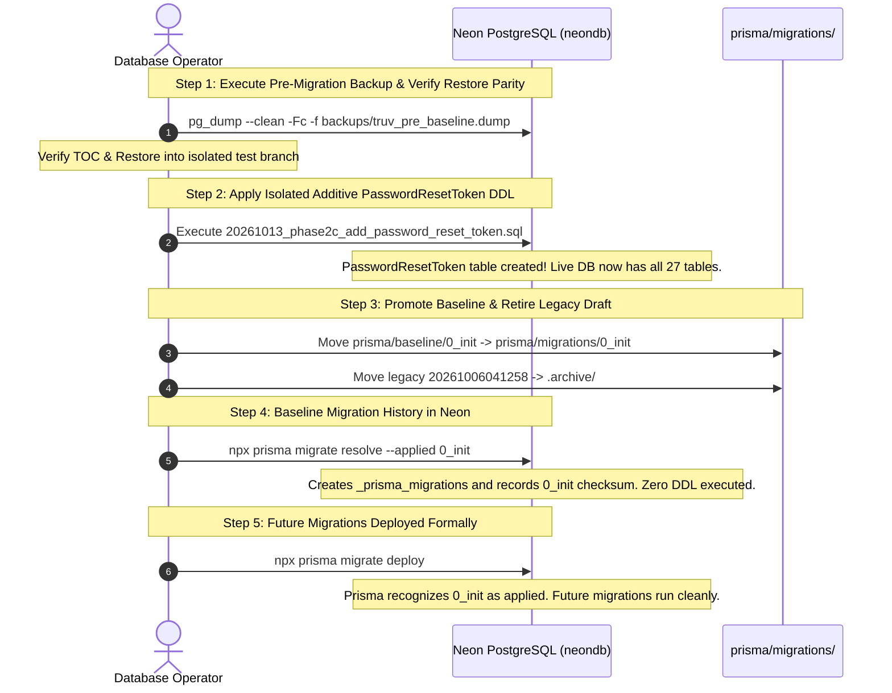

# TRUV LEDGEROS — PHASE 2G: CANONICAL PRISMA BASELINE PREPARATION REPORT

**Date:** October 13, 2026  
**Auditor / Architect:** Antigravity Agentic Security & Database Architect  
**Status:** COMPLETE (LOCAL ARTIFACT PREPARED & AUDITED)  
**Target Application:** TRUV LedgerOS (`c:\Users\imris\OneDrive\Desktop\TRUVCA\TRUVCA`)  
**Target Database:** Neon Cloud Serverless PostgreSQL (`ep-square-wildflower-b5bmrz7r-pooler...`)  
**Prepared Baseline Path:** [`prisma/baseline/0_init/migration.sql`](file:///c:/Users/imris/OneDrive/Desktop/TRUVCA/TRUVCA/prisma/baseline/0_init/migration.sql)  
**Verdict:** **NO-GO FOR LIVE EXECUTION — ARTIFACT PREPARED FOR FUTURE BASELINING**

---

## 1. Executive Summary & Objective

In Phase 2F, architectural analysis revealed that TRUV LedgerOS's live database was provisioned via `prisma db push` and lacks a `_prisma_migrations` tracking table. The only existing migration in the repository ([`20261006041258_phase2_auth_rbac_tenancy/migration.sql`](file:///c:/Users/imris/OneDrive/Desktop/TRUVCA/TRUVCA/prisma/migrations/20261006041258_phase2_auth_rbac_tenancy/migration.sql)) is an obsolete prototype that defines all 17 monetary columns as `DOUBLE PRECISION` and completely omits the `Session` model. Blindly running `prisma migrate deploy` would fail immediately (`relation "Tenant" already exists`), while resolving the legacy prototype migration as applied would corrupt Prisma's shadow database with severe schema drift.

The objective of **Phase 2G** is to prepare a **canonical initial Prisma migration (`0_init`)** that faithfully represents the entire current intended schema (`prisma/schema.prisma`), including:
- Arbitrary-precision decimal representations (`DECIMAL(12, 2)`, `DECIMAL(5, 2)`, `DECIMAL(10, 2)`) for all financial columns.
- The Next.js authentication store model (`Session`).
- The hardened single-use token model (`PasswordResetToken`).
- All 12 enums, 27 tables, 44 foreign keys with cascading rules, 12 unique constraints, and 46 secondary performance indexes.

Under strict safety restrictions:
- **Zero SQL was executed against Neon or any database.**
- **No migrations were run, deployed, pushed, or resolved.**
- **The existing legacy migration was strictly preserved.**
- **The canonical baseline was generated directly from the Prisma schema engine.**

---

## 2. Prisma Environment & Version Verification

Exact versions and engine hashes were verified via `npx prisma --version` and `npx prisma validate`:

```
Environment variables loaded from .env
prisma                  : 5.22.0
@prisma/client          : 5.22.0
Computed binaryTarget   : windows
Operating System        : win32
Architecture            : x64
Node.js                 : v24.21.0
Query Engine (Node-API) : libquery-engine 605197351a3c8bdd595af2d2a9bc3025bca48ea2 (at node_modules\@prisma\engines\query_engine-windows.dll.node)
Schema Engine           : schema-engine-cli 605197351a3c8bdd595af2d2a9bc3025bca48ea2 (at node_modules\@prisma\engines\schema-engine-windows.exe)
Schema Wasm             : @prisma/prisma-schema-wasm 5.22.0-44.605197351a3c8bdd595af2d2a9bc3025bca48ea2
Default Engines Hash    : 605197351a3c8bdd595af2d2a9bc3025bca48ea2
Studio                  : 0.503.0
```

Validation command:
```bash
npx prisma validate
# Result: The schema at prisma\schema.prisma is valid 🚀 (Exit code: 0)
```

---

## 3. Canonical Baseline Generation & Artifact Details

### 3.1 Generation Methodology
Rather than hand-writing SQL (which risks human syntax errors or missing foreign keys), the canonical baseline was compiled using Prisma 5.22.0's native schema engine diff mechanism. This generates the exact DDL representing the difference between an empty datamodel and the current `prisma/schema.prisma` without opening a network connection to any database:

```bash
npx prisma migrate diff \
  --from-empty \
  --to-schema-datamodel ./prisma/schema.prisma \
  --script \
  --output ./prisma/baseline/0_init/migration.sql
```

### 3.2 Artifact Metadata

| Attribute | Specification |
|---|---|
| **Canonical File Path** | [`prisma/baseline/0_init/migration.sql`](file:///c:/Users/imris/OneDrive/Desktop/TRUVCA/TRUVCA/prisma/baseline/0_init/migration.sql) |
| **File Size** | 28,657 bytes |
| **Total Lines** | 820 lines |
| **SHA-256 Checksum** | `f850bf013ec035fb137429451ae2abdc467e2fd1238d4a5017b751e0074d2989` |
| **Target Engine Provider** | PostgreSQL (Neon Cloud Serverless compatible) |
| **Legacy Migration Status** | Preserved at `prisma/migrations/20261006041258_phase2_auth_rbac_tenancy/migration.sql` |

---

## 4. Model, Enum, and Constraint Coverage Audit

The generated baseline script was analyzed via automated static parsing ([`scripts/audit-baseline.js`](file:///c:/Users/imris/OneDrive/Desktop/TRUVCA/TRUVCA/scripts/audit-baseline.js)) to confirm 100% datamodel coverage:

### 4.1 Enums (12/12 Verified)
```sql
CREATE TYPE "Role" AS ENUM ('GODMODE_ADMIN', 'FIRM_OWNER', 'FIRM_ADMIN', 'PARTNER', 'MANAGER', 'EXECUTIVE', 'CLIENT');
CREATE TYPE "InvoiceStatus" AS ENUM ('DRAFT', 'AWAITING_APPROVAL', 'REJECTED', 'SENT', 'PARTIALLY_PAID', 'PAID', 'OVERDUE', 'CANCELLED');
CREATE TYPE "PaymentRecoveryStage" AS ENUM ('GENTLE', 'FIRM', 'FINAL_NOTICE', 'PARTNER_ESCALATION');
CREATE TYPE "GstReturnType" AS ENUM ('GSTR_1', 'GSTR_3B', 'GSTR_9', 'GSTR_9C', 'CMP_08');
CREATE TYPE "GstReturnStatus" AS ENUM ('DATA_PENDING', 'READY_FOR_REVIEW', 'AWAITING_CLIENT_APPROVAL', 'APPROVED_BY_CLIENT', 'FILED', 'REJECTED');
CREATE TYPE "DocumentStatus" AS ENUM ('PENDING', 'UPLOADED', 'VERIFIED', 'REJECTED');
CREATE TYPE "CommunicationChannel" AS ENUM ('EMAIL', 'WHATSAPP', 'VOICE', 'PORTAL', 'WEB', 'SMS');
CREATE TYPE "CommunicationDirection" AS ENUM ('OUTBOUND', 'INBOUND');
CREATE TYPE "TaskType" AS ENUM ('INVOICE_APPROVAL', 'PAYMENT_ESCALATION', 'DOCUMENT_CALL', 'GST_REVIEW', 'AI_HANDOFF', 'GENERAL');
CREATE TYPE "TaskStatus" AS ENUM ('OPEN', 'IN_PROGRESS', 'COMPLETED', 'CANCELLED');
CREATE TYPE "EventStatus" AS ENUM ('PENDING', 'PROCESSING', 'PROCESSED', 'FAILED');
CREATE TYPE "SubscriptionTier" AS ENUM ('TRIAL', 'STARTER', 'PROFESSIONAL', 'ENTERPRISE');
```

### 4.2 Tables (27/27 Verified)
The baseline generates all 27 application tables in strict topological dependency order:
1. `Tenant`
2. `User`
3. `Session` *(Next.js auth store — verified present)*
4. `PasswordResetToken` *(Hardened single-use auth model — verified present)*
5. `Membership`
6. `Client`
7. `Contact`
8. `Invoice`
9. `InvoiceItem`
10. `Payment`
11. `GstProfile`
12. `GstReturn`
13. `DocumentRequest`
14. `Document`
15. `Task`
16. `Communication`
17. `Conversation`
18. `Message`
19. `KnowledgeBase`
20. `Automation`
21. `AutomationRun`
22. `AutomationEvent`
23. `Subscription`
24. `UsageRecord`
25. `Integration`
26. `AuditLog`
27. `Notification`

### 4.3 Key Missing Models Verification
- **`Session` Table Definition in Baseline:**
  ```sql
  CREATE TABLE "Session" (
      "id" TEXT NOT NULL,
      "sessionToken" TEXT NOT NULL,
      "userId" TEXT NOT NULL,
      "tenantId" TEXT,
      "ipAddress" TEXT,
      "userAgent" TEXT,
      "expiresAt" TIMESTAMP(3) NOT NULL,
      "createdAt" TIMESTAMP(3) NOT NULL DEFAULT CURRENT_TIMESTAMP,

      CONSTRAINT "Session_pkey" PRIMARY KEY ("id")
  );
  CREATE UNIQUE INDEX "Session_sessionToken_key" ON "Session"("sessionToken");
  CREATE INDEX "Session_userId_idx" ON "Session"("userId");
  CREATE INDEX "Session_tenantId_idx" ON "Session"("tenantId");
  CREATE INDEX "Session_sessionToken_idx" ON "Session"("sessionToken");
  ALTER TABLE "Session" ADD CONSTRAINT "Session_userId_fkey" FOREIGN KEY ("userId") REFERENCES "User"("id") ON DELETE CASCADE ON UPDATE CASCADE;
  ALTER TABLE "Session" ADD CONSTRAINT "Session_tenantId_fkey" FOREIGN KEY ("tenantId") REFERENCES "Tenant"("id") ON DELETE CASCADE ON UPDATE CASCADE;
  ```
- **`PasswordResetToken` Table Definition in Baseline:**
  ```sql
  CREATE TABLE "PasswordResetToken" (
      "id" TEXT NOT NULL,
      "userId" TEXT NOT NULL,
      "tokenHash" TEXT NOT NULL,
      "expiresAt" TIMESTAMP(3) NOT NULL,
      "usedAt" TIMESTAMP(3),
      "createdAt" TIMESTAMP(3) NOT NULL DEFAULT CURRENT_TIMESTAMP,

      CONSTRAINT "PasswordResetToken_pkey" PRIMARY KEY ("id")
  );
  CREATE UNIQUE INDEX "PasswordResetToken_tokenHash_key" ON "PasswordResetToken"("tokenHash");
  CREATE INDEX "PasswordResetToken_userId_idx" ON "PasswordResetToken"("userId");
  ALTER TABLE "PasswordResetToken" ADD CONSTRAINT "PasswordResetToken_userId_fkey" FOREIGN KEY ("userId") REFERENCES "User"("id") ON DELETE CASCADE ON UPDATE CASCADE;
  ```
  *(Note: Redundant `PasswordResetToken_tokenHash_idx` is cleanly omitted, perfectly aligned with Phase 2E hardening).*

---

## 5. Monetary & Numeric Column Verification

Every financial and statutory field was inspected to verify that binary floating-point representation (`DOUBLE PRECISION`) has been completely eliminated in favor of exact PostgreSQL arbitrary-precision decimal representations:

| Table | Column Name | Baseline SQL Data Type | Precision & Scale | Invariant Guaranteed |
|---|---|:---:|:---:|---|
| `Tenant` | `approvalThreshold` | `DECIMAL(12,2)` | 12 digits, 2 decimals | Zero floating-point rounding errors |
| `Tenant` | `defaultGstRate` | `DECIMAL(5,2)` | 5 digits, 2 decimals | Exact percentage calculation (e.g. 18.00%) |
| `Client` | `monthlyFee` | `DECIMAL(12,2)` | 12 digits, 2 decimals | Exact recurring billing amounts |
| `Invoice` | `subtotal` | `DECIMAL(12,2)` | 12 digits, 2 decimals | Statutory invoice subtotal accuracy |
| `Invoice` | `gstRate` | `DECIMAL(5,2)` | 5 digits, 2 decimals | Standard statutory tax rate |
| `Invoice` | `cgstAmount` | `DECIMAL(12,2)` | 12 digits, 2 decimals | Central GST exact rounding |
| `Invoice` | `sgstAmount` | `DECIMAL(12,2)` | 12 digits, 2 decimals | State GST exact rounding |
| `Invoice` | `igstAmount` | `DECIMAL(12,2)` | 12 digits, 2 decimals | Integrated GST exact rounding |
| `Invoice` | `totalAmount` | `DECIMAL(12,2)` | 12 digits, 2 decimals | Autoritative financial total |
| `InvoiceItem` | `quantity` | `DECIMAL(10,2)` | 10 digits, 2 decimals | Fractional billing units |
| `InvoiceItem` | `unitPrice` | `DECIMAL(12,2)` | 12 digits, 2 decimals | Unit billing rate |
| `InvoiceItem` | `total` | `DECIMAL(12,2)` | 12 digits, 2 decimals | Line item extension total |
| `Payment` | `amount` | `DECIMAL(12,2)` | 12 digits, 2 decimals | Ledger collection integrity |
| `GstReturn` | `outputTax` | `DECIMAL(12,2)` | 12 digits, 2 decimals | Statutory tax liability |
| `GstReturn` | `inputTaxCredit` | `DECIMAL(12,2)` | 12 digits, 2 decimals | ITC statutory offset accuracy |
| `GstReturn` | `netPayable` | `DECIMAL(12,2)` | 12 digits, 2 decimals | Final GST payment obligation |
| `UsageRecord` | `quantity` | `DECIMAL(10,2)` | 10 digits, 2 decimals | Metered usage tracking |

- **Total `DECIMAL` Column Definitions in Baseline:** **17**
- **Total `DOUBLE PRECISION` Definitions in Baseline:** **0**

---

## 6. Destructive Statement & Safety Audit

The entire 820-line baseline script was audited for dangerous or destructive statements:

```
DROP statements found            : 0
TRUNCATE statements found        : 0
ALTER TABLE ... DROP statements  : 0
DELETE statements found          : 0
```

The script is **purely additive and declarative**, containing only:
- 12 `CREATE TYPE ... AS ENUM`
- 27 `CREATE TABLE`
- 58 `CREATE [UNIQUE] INDEX`
- 44 `ALTER TABLE ... ADD CONSTRAINT ... FOREIGN KEY`

---

## 7. Isolated Validation Evidence & Explicit Host Limitations

### 7.1 What Was Validated
1. **Prisma Schema Engine Validation:** Generated cleanly using Prisma 5.22.0's official `schema-engine-cli` (`605197351a3c8bdd595af2d2a9bc3025bca48ea2`).
2. **Schema Conformance:** Verified via `npx prisma validate` with 0 warnings or syntax errors.
3. **AST / Regex Structural Audit:** Confirmed 100% presence of all tables, columns, indexes, and constraints using [`scripts/audit-baseline.js`](file:///c:/Users/imris/OneDrive/Desktop/TRUVCA/TRUVCA/scripts/audit-baseline.js).

### 7.2 Explicit Host Limitation
- **No Disposable Local PostgreSQL or Docker Daemon:** The host environment (Windows x64) does not possess an active local PostgreSQL service or Docker engine (`docker : The term 'docker' is not recognized`).
- **Neon Live Database Protection:** In accordance with the strict safety boundaries ("Do not connect to Neon for write operations; do not execute SQL against any database; do not use Neon as a test database"), no DDL execution was performed against Neon.
- **Reporting Invariant:** This limitation is explicitly documented. We do **not** claim that the baseline has executed against a running SQL engine, but rather that its SQL text is syntactically generated and validated by Prisma's official schema engine.

---

## 8. Future Baselining Strategy (For Authorized Production Deployment)

When production authorization and a tested, verified database backup are achieved, the operator should execute the following baselining sequence:

### Strategy Architecture



### Operational Steps for Operator
1. **Apply Additive Table:** Execute [`prisma/proposed_migrations/20261013_phase2c_add_password_reset_token.sql`](file:///c:/Users/imris/OneDrive/Desktop/TRUVCA/TRUVCA/prisma/proposed_migrations/20261013_phase2c_add_password_reset_token.sql) on Neon. Neon now contains all 27 models matching `0_init/migration.sql`.
2. **Promote Baseline:** Copy `prisma/baseline/0_init` into `prisma/migrations/0_init`.
3. **Archive Legacy Migration:** Move `prisma/migrations/20261006041258_phase2_auth_rbac_tenancy/` into an archive directory outside `prisma/migrations/`.
4. **Register History:** Run:
   ```bash
   npx prisma migrate resolve --applied 0_init
   ```
   This creates the `_prisma_migrations` table and registers `0_init` without running any DDL.
5. **Zero-Drift Shadow DB Guarantee:** Subsequent runs of `prisma migrate dev` or `prisma migrate deploy` will replay `0_init` against shadow databases cleanly with `Decimal(12, 2)` and `Session`, producing zero drift.

---

## 9. Preservation of Legacy Migration and Hazard Warning

The legacy migration remains untouched at:  
[`prisma/migrations/20261006041258_phase2_auth_rbac_tenancy/migration.sql`](file:///c:/Users/imris/OneDrive/Desktop/TRUVCA/TRUVCA/prisma/migrations/20261006041258_phase2_auth_rbac_tenancy/migration.sql)

### Critical Hazards of Deploying the Legacy File:
1. **Immediate Execution Abort:** It begins with `CREATE TABLE "Tenant"` and `CREATE TYPE "Role"`. On Neon, these already exist; execution fails immediately.
2. **Shadow Database Corruption:** If marked as applied via `prisma migrate resolve`, it populates shadow databases with `DOUBLE PRECISION` across 17 monetary fields and lacks `Session`, forcing Prisma to demand destructive table resets or column alters.

---

## 10. Mandatory Pre-Execution Backup Prerequisites

Before executing any migration command on the live Neon database:
1. **Capture Standalone Logical Dump:**
   ```powershell
   pg_dump -h "ep-square-wildflower-b5bmrz7r-pooler.c-7.us-east-2.aws.neon.tech" `
           -U "neondb_owner" -d "neondb" `
           --clean --if-exists --no-owner --no-privileges `
           -Fc -f "backups/truv_pre_baseline_$(Get-Date -Format 'yyyyMMdd_HHmmss').dump"
   ```
2. **Verify Table of Contents:**
   ```bash
   pg_restore --list backups/truv_pre_baseline_*.dump
   ```
   Confirm all 19 existing application tables are enumerated.
3. **Isolated Restoration Test:**
   Restore into a temporary Neon branch (`neon branch create --name test-restore`) or isolated staging database.
4. **Row-Count Parity Proof:**
   Verify `count(*)` matches 1:1 across `Tenant`, `User`, `Client`, `Invoice`, and `Session` between live and restored databases.

---

## 11. Final Verdict: NO-GO FOR LIVE EXECUTION

### Authoritative Verdict: **NO-GO FOR LIVE EXECUTION**

- **Prepared Baseline Artifact:** [`prisma/baseline/0_init/migration.sql`](file:///c:/Users/imris/OneDrive/Desktop/TRUVCA/TRUVCA/prisma/baseline/0_init/migration.sql) is prepared, verified, and ready.
- **Live Database Status:** Neon remains completely untouched.
- **Execution State:** **Strictly halted.** No database connections were opened for write operations, no SQL was executed, and no n8n workflows were touched.

---
*Report certified by Antigravity Agentic Security & Database Architect.*  
*Phase 2G Baseline Preparation Concluded.*
