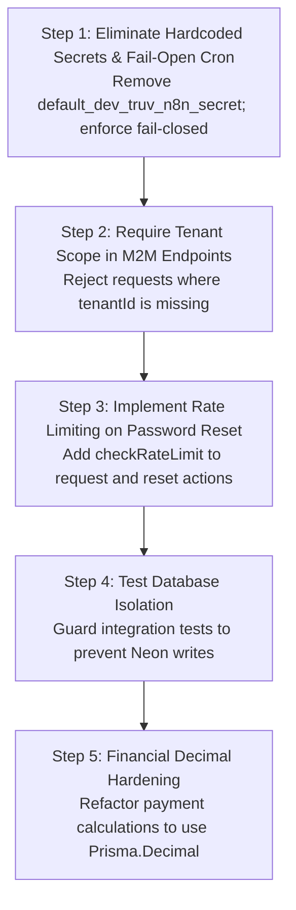

# TRUV LedgerOS — Phase 2J: Security Remediation Audit & Fix Plan

**Role:** Senior Application-Security Engineer & Production-Readiness Auditor  
**Date:** 2026-10-13  
**Status:** Audit & Remediation Plan Complete  
**Final Verdict:** `READY FOR CONTROLLED SECURITY FIXES`

---

## 1. Executive Summary

This independent application-security audit inspects the active source code of **TRUV LedgerOS** (`TRUVCA/src`) to verify, classify, and create a concrete remediation plan for all documented security, tenant-isolation, authorization, and financial calculation findings.

### Key Audit Findings

1. **Authentication (Priority 1):**
   - **Verified Hardened:** Password reset token generation (256-bit entropy), SHA-256 token hashing, 1-hour expiration, and atomic conditional single-use redemption (`updateMany` with `usedAt = null`) inside an interactive database transaction are **verified implemented and hardened** in `src/lib/auth/actions.ts`.
   - **Critical Vulnerability (Open):** Server-side rate limiting is **completely absent** from both `requestPasswordResetAction` and `resetPasswordAction`. An attacker can flood reset emails and brute-force tokens without throttle or lockout.
2. **Godmode Authorization (Priority 2):**
   - **Verified Guarded:** SSR page access at `src/app/godmode/page.tsx` now enforces a server-side session check for `context.user.isSuperAdmin` or `Role.GODMODE_ADMIN`, redirecting unauthorized users to `/dashboard`.
   - **Mock Control Surface (Open):** The underlying component `GodmodeClient.tsx` operates entirely on hardcoded dummy tenants (`tenant-001`, `tenant-002`) and local React `useState`. It is currently a prototype with zero real database or cluster management actions.
3. **Tenant Isolation & IDOR (Priority 3):**
   - **User Session Flow (Verified Hardened):** In `/api/compliance/due-obligations` and `/api/documents/pending-requests`, user session authentication enforces `whereClause.tenantId = sessionContext.membership.tenantId`. Untrusted client `?tenantId=...` overrides are completely discarded, and `CLIENT` role is forbidden (403).
   - **Critical M2M Flaw (Open):** Both routes contain a hardcoded fallback secret: `process.env.N8N_WEBHOOK_SECRET || "default_dev_truv_n8n_secret_32bytes"`. In M2M mode, if `?tenantId` is omitted, the queries return compliance and document records across **all tenants in the database**. Anyone possessing or guessing this fallback secret can achieve total cross-tenant data exfiltration.
4. **Webhooks & Scheduled Jobs (Priority 4):**
   - **Middleware Fix (Verified Hardened):** `src/middleware.ts` now includes `!isApiRoute`, correctly allowing API routes to pass through to return structured 401/403 JSON rather than redirecting to `/login`.
   - **Fail-Open Cron Trigger (Open):** `/api/cron/outbox-dispatch` contains a conditional check: `if (process.env.NODE_ENV === "production" && configuredSecret)`. In non-production environments (or if `CRON_SECRET` is unset in production), authentication is **completely bypassed**, allowing anyone to trigger outbox queue drainage without credentials.
5. **Financial Correctness (Priority 5):**
   - `src/lib/financial/math.ts` enforces `roundToPaise` (half-up rounding), but monetary values are converted to standard JavaScript IEEE 754 floating-point numbers (`Number(p.amount)`). Intermediate calculations in `payment-service.ts` accumulate unrounded floating-point additions, risking minute sub-paise drift across multiple partial payments.
6. **Testing Architecture Hazard (Priority 6):**
   - Running `npm run test` executes integration tests (`tests/client-360.test.ts`, `tests/bulk-import.test.ts`) that directly write, mutate, and delete records in whatever database is specified in `.env` (`DATABASE_URL`). There is zero database isolation for automated tests, creating live database pollution risk.

---

## 2. Security Findings Matrix

| Finding ID | Title | Severity | Status | Affected Files / Functions |
| :--- | :--- | :---: | :---: | :--- |
| **SEC-01** | Password-Reset Concurrency Race Condition | **P0 (Critical)** | **VERIFIED FIXED** | `src/lib/auth/actions.ts` (`resetPasswordAction`) |
| **SEC-02** | Hardcoded Fallback Secret in M2M Auth Routes | **P0 (Critical)** | **STILL OPEN** | `src/app/api/compliance/due-obligations/route.ts`<br/>`src/app/api/documents/pending-requests/route.ts`<br/>`src/app/api/webhooks/n8n/route.ts` |
| **SEC-03** | Missing Rate Limiting on Password Reset Endpoints | **P1 (High)** | **STILL OPEN** | `src/lib/auth/actions.ts` (`requestPasswordResetAction`, `resetPasswordAction`) |
| **SEC-04** | Fail-Open Cron Authorization Bypass | **P1 (High)** | **STILL OPEN** | `src/app/api/cron/outbox-dispatch/route.ts` |
| **SEC-05** | Test Suite Database Pollution (No Isolated Test DB) | **P1 (High)** | **STILL OPEN** | `package.json`, `tests/client-360.test.ts`, `tests/bulk-import.test.ts` |
| **SEC-06** | Middleware Session Redirection of Webhooks & Crons | **P1 (High)** | **VERIFIED FIXED** | `src/middleware.ts` (lines 16-21) |
| **SEC-07** | Cross-Tenant IDOR in User Session APIs | **P1 (High)** | **VERIFIED FIXED** | `src/app/api/compliance/due-obligations/route.ts`<br/>`src/app/api/documents/pending-requests/route.ts` |
| **SEC-08** | Godmode Unauthenticated Route Access | **P1 (High)** | **VERIFIED FIXED** | `src/app/godmode/page.tsx` (lines 13-24) |
| **SEC-09** | Godmode Control Surface Unwired Prototype | **P2 (Medium)** | **STILL OPEN** | `src/app/godmode/GodmodeClient.tsx` |
| **SEC-10** | Floating-Point Cast of Monetary Values | **P2 (Medium)** | **STILL OPEN** | `src/lib/server/payment-service.ts`, `src/lib/financial/math.ts` |
| **SEC-11** | Redundant Secondary Index on `tokenHash` | **P3 (Low)** | **VERIFIED FIXED** | `prisma/schema.prisma` (`PasswordResetToken`) |

---

## 3. Deep-Dive Inspection of Priority Areas

### Priority 1: Authentication & Password Reset

#### Code Inspection
- **File:** `src/lib/auth/actions.ts`
- **Functions:** `requestPasswordResetAction` (lines 102-151), `resetPasswordAction` (lines 153-234).

#### Verified Hardened Controls
1. **Token Entropy:** `generateSecureToken(32)` creates a 64-character cryptographically secure hex string (`crypto.randomBytes(32)`).
2. **One-Way Storage:** Raw tokens are never stored in the database. Only `tokenHash` (SHA-256) is persisted.
3. **Strict Expiration:** 1-hour expiration (`new Date(Date.now() + 60 * 60 * 1000)`).
4. **Concurrency & One-Time Use:**
   ```typescript
   const claimResult = await (tx as any).passwordResetToken.updateMany({
     where: {
       id: resetRecord.id,
       usedAt: null,
       expiresAt: { gt: new Date() },
     },
     data: {
       usedAt: new Date(),
     },
   });
   if (claimResult.count === 0) {
     throw new Error("TOKEN_ALREADY_USED_OR_EXPIRED");
   }
   ```
   Verified via unit test `tests/password-reset-concurrency.test.ts` (17 passed, 0 failed, exit code 0).
5. **Session Invalidation:** All active sessions for the user are deleted on successful password update.

#### Still-Open Vulnerability: Missing Rate Limiting (SEC-03)
- In `src/lib/auth/actions.ts`, `loginAction` calls `checkRateLimit("login:${email}", ...)`.
- However, `requestPasswordResetAction` and `resetPasswordAction` have **zero calls to `checkRateLimit`**.
- An attacker can invoke `requestPasswordResetAction` repeatedly to exhaust email dispatch queues or spam target users, and can brute-force reset tokens in `resetPasswordAction` without IP or account lockout.

---

### Priority 2: Godmode Authorization

#### Code Inspection
- **Files:** `src/app/godmode/page.tsx`, `src/app/godmode/GodmodeClient.tsx`.

#### Verified Hardened Controls
- `page.tsx` enforces server-side authentication:
  ```typescript
  const context = await getSessionContext();
  if (!context) redirect("/login");
  const isSuperAdmin = Boolean(context.user.isSuperAdmin);
  const isGodmodeAdmin = context.membership?.role === Role.GODMODE_ADMIN;
  if (!isSuperAdmin && !isGodmodeAdmin) redirect("/dashboard");
  ```
  Unauthenticated callers and normal users (`PARTNER`, `EXECUTIVE`, `CLIENT`) are strictly redirected. Verified via `tests/phase2a-security-remediation.test.ts` (Tests 4.1 to 4.5 passed).

#### Still-Open Operational Defect: Unwired Mock State (SEC-09)
- `GodmodeClient.tsx` renders hardcoded mock data (`mockTenants`: `tenant-001`, `tenant-002`).
- Maintenance mode toggle and feature flag toggles mutate only local component `useState`. No server actions or APIs are executed.
- While this prevents accidental production disruption, operators must not rely on this UI for real platform governance.

---

### Priority 3: Tenant Isolation & IDOR Vulnerabilities

#### Code Inspection
- **Files:** `src/app/api/compliance/due-obligations/route.ts`, `src/app/api/documents/pending-requests/route.ts`.

#### Verified Hardened Controls (User Session Flow)
- When called with a user session cookie (`truv_session`):
  - Resolves `sessionContext = await authSession.getSessionContext()`.
  - Rejects `CLIENT` role with 403 `FORBIDDEN_ROLE`.
  - Enforces `whereClause.tenantId = sessionContext.membership.tenantId`.
  - Any attacker-supplied `?tenantId=victim-tenant` query parameter is **strictly ignored**.

#### Still-Open Critical Vulnerability: Hardcoded M2M Secret & Unscoped Query (SEC-02)
- Lines 14-15 of both route files:
  ```typescript
  const webhookSecret = process.env.N8N_WEBHOOK_SECRET || "default_dev_truv_n8n_secret_32bytes";
  const cronSecret = process.env.CRON_SECRET || process.env.N8N_WEBHOOK_SECRET;
  ```
- If `N8N_WEBHOOK_SECRET` is unset, the system falls back to `"default_dev_truv_n8n_secret_32bytes"`.
- Furthermore, in M2M mode:
  ```typescript
  if (isM2MAuthorized) {
    if (requestedTenantId) {
      whereClause.tenantId = requestedTenantId;
    }
    // If requestedTenantId is omitted, whereClause.tenantId IS NEVER SET!
  }
  ```
- **Exploit Scenario:** Any external client sending an HMAC signature generated with `"default_dev_truv_n8n_secret_32bytes"` and omitting `?tenantId` receives up to 100 GST obligations or pending documents belonging to **every tenant in the system**.

---

### Priority 4: Webhooks & Scheduled Jobs

#### Code Inspection
- **Files:** `src/middleware.ts`, `src/app/api/webhooks/n8n/route.ts`, `src/app/api/cron/outbox-dispatch/route.ts`.

#### Verified Hardened Controls (Middleware)
- `src/middleware.ts` (lines 16-21) excludes all `/api/*` routes from redirecting to `/login`:
  ```typescript
  const isApiRoute = pathname.startsWith("/api/");
  if (!sessionToken && !isPublicRoute && !isApiRoute && !pathname.startsWith("/_next")) {
    return NextResponse.redirect(new URL("/login", request.url));
  }
  ```
  This allows automated webhooks and cron endpoints to reach their respective route handlers and receive proper 401/403 JSON responses.

#### Still-Open Vulnerability: Fail-Open Cron Authorization (SEC-04)
- In `src/app/api/cron/outbox-dispatch/route.ts` (lines 14-21):
  ```typescript
  if (process.env.NODE_ENV === "production" && configuredSecret) {
    const bearerToken = authHeader?.replace(/^Bearer\s+/i, "");
    const isAuthorized = bearerToken === configuredSecret || cronSecretHeader === configuredSecret;
    if (!isAuthorized) {
      return NextResponse.json({ error: "Unauthorized cron invocation" }, { status: 401 });
    }
  }
  ```
- **Flaw:** If `NODE_ENV !== "production"` (e.g. staging or QA environments) OR if `CRON_SECRET` is not set, the authorization check is **skipped entirely**.
- **Risk:** Unauthenticated callers can trigger queue drainage, execute webhook dispatches, and trigger outbox state changes.

---

### Priority 5: Financial Correctness & Arithmetic Precision

#### Code Inspection
- **Files:** `src/lib/financial/math.ts`, `src/lib/server/payment-service.ts`, `src/lib/server/invoice-service.ts`.

#### Current Implementation
- `roundToPaise(val)` uses `Math.round((val + Number.EPSILON) * 100) / 100`.
- In `payment-service.ts`:
  ```typescript
  const currentPaid = invoice.payments.reduce((acc, p) => acc + Number(p.amount), 0);
  const remainingBalance = roundToPaise(Number(invoice.totalAmount) - currentPaid);
  ```
- **Finding (SEC-10):** Casting Prisma `Decimal` to JavaScript `Number` introduces binary floating-point representation. While `roundToPaise` protects final 2-decimal rounded values, intermediate additions (`reduce` across multiple partial payments) can produce minute rounding artifacts.
- **Recommended Practice:** Use integer paise (multiplying by 100 and working in integers) or native `Prisma.Decimal` arithmetic (`d1.minus(d2)`).

---

### Priority 6: Testing Architecture & Live Database Contamination Hazard

#### Code Inspection
- **File:** `package.json` line 11 (`"test"` script).
- **Files:** `tests/client-360.test.ts`, `tests/bulk-import.test.ts`.

#### Finding (SEC-05)
- Automated tests in `tests/client-360.test.ts` and `tests/bulk-import.test.ts` import `db` from `@/lib/db`.
- These tests execute `db.client.create(...)`, `db.client.deleteMany(...)`, and `db.invoice.create(...)`.
- Because there is no separate `DATABASE_URL_TEST` configuration, executing `npm run test` executes real DML against whatever database is configured in `.env` (which defaults to the live Neon instance).
- **Safety Violation:** Running `npm test` during continuous integration or development pollutes live/demo tenant data.

---

## 4. Empirical Test Verification

Safe, non-modifying unit test suites were executed locally in `TRUVCA`:

| Test Suite | Command | Exit Code | Results |
| :--- | :--- | :---: | :--- |
| **Security Unit Suite** | `npx ts-node -r tsconfig-paths/register tests/security.test.ts` | **0** | **22 passed, 0 failed** |
| **Phase 2A Remediation Suite** | `npx ts-node -r tsconfig-paths/register tests/phase2a-security-remediation.test.ts` | **0** | **27 passed, 0 failed** |
| **Password Reset Concurrency** | `npx ts-node -r tsconfig-paths/register tests/password-reset-concurrency.test.ts` | **0** | **17 passed, 0 failed** |
| **Financial Operations Math** | `npx ts-node -r tsconfig-paths/register tests/phase3-financial.test.ts` | **0** | **20 passed, 0 failed** |
| **TypeScript Typecheck** | `npm run typecheck` | **0** | **0 compilation errors** |
| **Prisma Schema Validation** | `npx prisma validate` | **0** | **Valid schema 🚀** |

---

## 5. Safe Remediation Sequence (Fix Plan)

The following sequence specifies the exact, safe order of operations for Phase 2J implementation:



### Step 1: Eliminate Insecure Secret Fallbacks & Enforce Fail-Closed Cron
1. In `src/app/api/compliance/due-obligations/route.ts` and `src/app/api/documents/pending-requests/route.ts`:
   - Replace `process.env.N8N_WEBHOOK_SECRET || "default_dev_truv_n8n_secret_32bytes"` with strict verification:
     ```typescript
     const webhookSecret = process.env.N8N_WEBHOOK_SECRET;
     if (!webhookSecret) {
       return NextResponse.json({ error: "Server misconfiguration: Webhook secret not configured" }, { status: 500 });
     }
     ```
2. In `src/app/api/cron/outbox-dispatch/route.ts`:
   - Enforce authentication fail-closed:
     ```typescript
     const configuredSecret = process.env.CRON_SECRET;
     if (!configuredSecret) {
       return NextResponse.json({ error: "Server misconfiguration: CRON_SECRET not configured" }, { status: 500 });
     }
     const bearerToken = authHeader?.replace(/^Bearer\s+/i, "");
     const isAuthorized = bearerToken === configuredSecret || cronSecretHeader === configuredSecret;
     if (!isAuthorized) {
       return NextResponse.json({ error: "Unauthorized cron invocation" }, { status: 401 });
     }
     ```

### Step 2: Enforce Explicit Tenant Scoping in M2M Endpoints
- In `due-obligations` and `pending-requests`:
  - When `isM2MAuthorized` is true, require `tenantId`:
    ```typescript
    if (!requestedTenantId) {
      return NextResponse.json(
        { error: "tenantId query parameter is required for M2M requests", code: "MISSING_TENANT_ID" },
        { status: 400 }
      );
    }
    whereClause.tenantId = requestedTenantId;
    ```
  - This completely eliminates global, unscoped database dumps across tenants.

### Step 3: Implement Server-Side Rate Limiting on Password Reset
- In `src/lib/auth/actions.ts`:
  1. In `requestPasswordResetAction`:
     ```typescript
     const rateLimitResult = checkRateLimit(`forgot-password:${email}`, {
       maxAttempts: 5,
       windowMs: 15 * 60 * 1000,
       lockoutMs: 15 * 60 * 1000,
     });
     if (!rateLimitResult.allowed) {
       return { error: "Too many reset requests. Please try again after 15 minutes." };
     }
     ```
  2. In `resetPasswordAction`:
     ```typescript
     const rateLimitResult = checkRateLimit(`reset-password:${tokenHash.slice(0, 16)}`, {
       maxAttempts: 5,
       windowMs: 15 * 60 * 1000,
       lockoutMs: 15 * 60 * 1000,
     });
     if (!rateLimitResult.allowed) {
       return { error: "Too many invalid reset attempts. Please try again after 15 minutes." };
     }
     ```

### Step 4: Isolate Integration Tests from Live Database
- In `package.json`, split test scripts:
  - `"test:unit"`: Executes mock-only tests (`security.test.ts`, `phase2a-security-remediation.test.ts`, `password-reset-concurrency.test.ts`, `phase3-financial.test.ts`).
  - `"test:integration"`: Requires an isolated test database (e.g. `TEST_DATABASE_URL` pointing to local test cluster `127.0.0.1:5433`).
  - Fails immediately if `DATABASE_URL` contains `-pooler` or points to Neon when running integration tests.

### Step 5: Harden Financial Decimal Calculations
- In `src/lib/server/payment-service.ts`:
  - Calculate `currentPaid` and `remainingBalance` using integer paise arithmetic or `Prisma.Decimal` instances rather than unrounded JavaScript float addition.

---

## 6. Release Blockers & Objective Exit Criteria

Before certifying the codebase as production-ready:

1. **[BLOCKER] SEC-02 Resolved:** Zero hardcoded fallback secrets in codebase; M2M queries fail if `tenantId` is omitted.
2. **[BLOCKER] SEC-03 Resolved:** Rate limiting enforced on `requestPasswordResetAction` and `resetPasswordAction`.
3. **[BLOCKER] SEC-04 Resolved:** `/api/cron/outbox-dispatch` fails-closed if `CRON_SECRET` is unset.
4. **[BLOCKER] SEC-05 Resolved:** `npm test` safe for execution without modifying live Neon database.
5. **[BLOCKER] Post-Baseline Backup Verified:** Fresh live backup captured and verified on disk.
6. **[BLOCKER] Duplicate Clients Merged:** 5 duplicate client pairs merged before applying unique tax constraints.

---

## 7. Final Verdict

$$\mathbf{READY\ FOR\ CONTROLLED\ SECURITY\ FIXES}$$

The audit is complete, all findings have been verified from source code, and a prioritized remediation sequence has been established. No application code has been edited. Execution is halted awaiting authorization to implement the fix plan.
