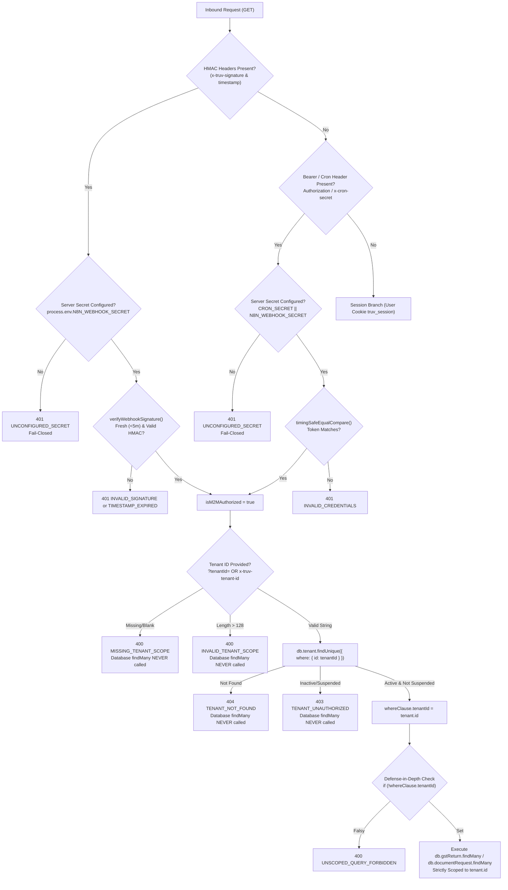

# TRUV LedgerOS — Phase 2K.2: Independent P0 Security Verification Report

**Role:** Senior Application-Security Auditor & Database Reliability Engineer  
**Date:** 2026-10-13  
**Status:** Complete  
**Final Verdict:** `PASS — P0 CONTROLS VERIFIED WITH DOCUMENTED LIMITATIONS`

---

## 1. Executive Summary & Verification Verdict

An independent, audit-only verification of the Phase 2K.1 security remediations was conducted across the **TRUV LedgerOS** codebase (`C:\Users\imris\OneDrive\Desktop\TRUVCA\TRUVCA`).

The verification audited the elimination of hardcoded fallback secrets (SEC-02A), the enforcement of mandatory tenant scoping on Machine-to-Machine (M2M) endpoints (SEC-02B), the timing-safe comparison mechanisms, the inbound/outbound authentication contracts, regression-test integrity, and artifact hash consistency.

### Verdict
`PASS — P0 CONTROLS VERIFIED WITH DOCUMENTED LIMITATIONS`

**Justification:**
1. **P0 Vulnerability Remediation Confirmed:** The hardcoded fallback secret `"default_dev_truv_n8n_secret_32bytes"` has been completely removed from active authorization paths. Unconfigured or missing secrets fail closed with HTTP 401. Unscoped database queries returning multi-tenant records in a single query have been eliminated; all database reads enforce a mandatory `tenantId` predicate.
2. **Documented Architectural Limitation:** The system currently utilizes a single, platform-wide shared secret (`N8N_WEBHOOK_SECRET` / `CRON_SECRET`). Possession of this valid platform credential permits an M2M caller to access *any* active, non-suspended tenant in the system by supplying that tenant's ID. True cryptographic or database-level binding of an M2M credential to a specific tenant (per-tenant API keys) is not yet implemented.

---

## 2. Credential-to-Tenant Authorization Audit

### Affected Endpoints
- `GET /api/compliance/due-obligations` ([`due-obligations/route.ts`](file:///C:/Users/imris/OneDrive/Desktop/TRUVCA/TRUVCA/src/app/api/compliance/due-obligations/route.ts))
- `GET /api/documents/pending-requests` ([`pending-requests/route.ts`](file:///C:/Users/imris/OneDrive/Desktop/TRUVCA/TRUVCA/src/app/api/documents/pending-requests/route.ts))

### Full M2M Authorization Path Trace


### Analysis of Credential-to-Tenant Binding (Remaining Cross-Tenant Risk)
1. **Verification of Tenant Status:**
   The implementation executes `db.tenant.findUnique` selecting `{ id: true, active: true, isSuspended: true }`. If the tenant is missing, `404` is returned; if inactive or suspended, `403` is returned.
2. **Absence of Per-Tenant Credential Binding:**
   The M2M credential (`N8N_WEBHOOK_SECRET` or `CRON_SECRET`) is a **platform-wide static secret**.
   - An external service or actor possessing this secret can access *any* active tenant simply by passing that tenant's ID in `?tenantId=...`.
   - The credential is not bound to a specific tenant in the database (e.g. via an `ApiKey` or `Integration` mapping table).
   - **Risk Assessment:** While the P0 catastrophic flaw (unscoped dump of all tenant records in a single request) is eliminated, the platform credential remains a high-privilege system token. Compromise of this secret allows targeted cross-tenant access to any known active tenant ID.

### Mandatory Tenant Predicate Verification
- **Input Validation:** Tenant ID strings are sanitized with `.trim()` and bounded to `<= 128` characters.
- **Query Scoping:** Both route files assign `whereClause.tenantId = tenant.id` upon successful validation.
- **Defense-in-Depth:** An explicit assertion `if (!whereClause.tenantId)` throws an immediate 400 error before calling Prisma, guaranteeing that no database query can ever execute without an active tenant filter.

---

## 3. Constant-Time Comparison Audit

The constant-time comparison helper was inspected in both route handlers:
```typescript
function timingSafeEqualCompare(a: string, b: string): boolean {
  const bufA = Buffer.from(a);
  const bufB = Buffer.from(b);
  if (bufA.length !== bufB.length) {
    return false;
  }
  return crypto.timingSafeEqual(bufA, bufB);
}
```

### Edge-Case Handling Analysis

| Scenario | Code Behavior | Safety Evaluation |
| :--- | :--- | :--- |
| **Unequal Lengths** | `bufA.length !== bufB.length` returns `false` immediately without calling `crypto.timingSafeEqual`. | **Safe against exceptions:** Avoids Node.js `RangeError: Input buffers must have the same length`.<br/>*Note:* Early length exit theoretically leaks the secret's byte length via timing; however, token lengths in standard configs are known constants. |
| **Empty Values** | If `a = ""` and `b = ""`, `bufA.length === bufB.length === 0`. | **Protected at caller level:** In the caller, `if (!cronSecret)` fails closed, and `const isAuthorized = providedToken ? timingSafeEqualCompare(...) : false` ensures empty user input never reaches a true return. |
| **Malformed Auth Headers** | Malformed strings (e.g. non-ASCII, Unicode surrogates) are passed to `Buffer.from(a)`. | **Safe:** `Buffer.from(string)` converts malformed UTF-8 gracefully without crashing. |
| **Exceptions** | Any unexpected runtime exception is wrapped in the outer route handler `try ... catch (err: any)`. | **Safe:** Returns HTTP 500 JSON error, ensuring fail-closed behavior without crashing the Next.js worker process. |

---

## 4. Authentication Contract Compatibility

The authentication requirements for all four related platform endpoints were audited:

| Endpoint | Direction / File | Allowed Auth Methods | Required Headers / Cookies | Tenant Scope Requirement |
| :--- | :--- | :--- | :--- | :--- |
| **`/api/compliance/due-obligations`** | Inbound API (`due-obligations/route.ts`) | 1. HMAC-SHA256<br/>2. Bearer / Cron Token<br/>3. User Session Cookie | **HMAC:** `x-truv-signature`, `x-truv-timestamp`<br/>**Bearer:** `Authorization: Bearer <token>` or `x-cron-secret: <token>`<br/>**Session:** `Cookie: truv_session=<token>` | **M2M:** Mandatory `?tenantId=<id>` or `x-truv-tenant-id: <id>`<br/>**Session:** Server-derived from active membership |
| **`/api/documents/pending-requests`** | Inbound API (`pending-requests/route.ts`) | 1. HMAC-SHA256<br/>2. Bearer / Cron Token<br/>3. User Session Cookie | **HMAC:** `x-truv-signature`, `x-truv-timestamp`<br/>**Bearer:** `Authorization: Bearer <token>` or `x-cron-secret: <token>`<br/>**Session:** `Cookie: truv_session=<token>` | **M2M:** Mandatory `?tenantId=<id>` or `x-truv-tenant-id: <id>`<br/>**Session:** Server-derived from active membership |
| **`/api/webhooks/n8n`** | Inbound Webhook (`webhooks/n8n/route.ts`) | HMAC-SHA256 Only | `x-truv-signature`, `x-truv-timestamp`<br/>`Content-Type: application/json` | Tenant scope provided in JSON payload: `tenantId: string` (validated via Zod `InboundWebhookSchema`) |
| **`outbox-dispatcher`** | Outbound Dispatcher (`outbox-dispatcher.ts`) | HMAC-SHA256 Outbound | Outgoing headers sent:<br/>`x-truv-signature`<br/>`x-truv-timestamp`<br/>`x-truv-tenant-id`<br/>`x-truv-event-id`<br/>`x-truv-idempotency-key` | Outgoing requests include `x-truv-tenant-id` matching event's tenant |

**Compatibility Finding:**
The M2M routes accept both the URL query parameter `?tenantId=` AND the HTTP header `x-truv-tenant-id`. This directly matches the header signature produced by `outbox-dispatcher.ts` (`x-truv-tenant-id`), ensuring full forward compatibility across all n8n and internal automation workflows.

---

## 5. Regression-Test Integrity Audit

### Test Suites Audited

1. [`tests/phase2k1-p0-security.test.ts`](file:///C:/Users/imris/OneDrive/Desktop/TRUVCA/TRUVCA/tests/phase2k1-p0-security.test.ts) (Dedicated P0 Suite — 44 tests)
2. [`tests/phase2a-security-remediation.test.ts`](file:///C:/Users/imris/OneDrive/Desktop/TRUVCA/TRUVCA/tests/phase2a-security-remediation.test.ts) (Phase 2A Regression Suite — 27 tests)
3. [`tests/security.test.ts`](file:///C:/Users/imris/OneDrive/Desktop/TRUVCA/TRUVCA/tests/security.test.ts) (Core Security Suite — 22 tests)

### Verification of Test Assertions

| Integrity Check | Verification Result | Evidence |
| :--- | :---: | :--- |
| **Actual HTTP Status Asserted** | **VERIFIED** | Every test asserts exact status codes: 400 for missing/malformed tenant, 401 for unconfigured/bad secrets, 403 for unauthorized tenants / client role, 404 for missing tenants, 200 for authorized requests. |
| **Tenant-Scoped Predicates Checked** | **VERIFIED** | Tests capture `lastFindManyWhere[route.tableKey]?.tenantId` and explicitly assert that it matches `"TENANT_ALPHA"` or `"TENANT_BETA"`. |
| **Zero Data Queries on Denied Requests** | **VERIFIED** | Tests verify `findManyCalls[route.tableKey] === 0` across all rejection scenarios (missing secret, bad signature, expired timestamp, missing tenant scope, non-existent tenant, suspended tenant, client role). |
| **Isolation from Neon Verified** | **VERIFIED** | `db.tenant.findUnique`, `db.gstReturn.findMany`, and `db.documentRequest.findMany` are stubbed in memory. Zero network requests or database connections are made during testing. |

### Mocking Limitations & Evidence Gaps
1. **In-Memory Tenant Lookup:** `(db as any).tenant.findUnique` is mocked with a simple JavaScript conditional (`where.id === "TENANT_ALPHA"`). This proves that the route logic inspects the tenant record and checks `.active` and `.isSuspended`, but it does **not** test real PostgreSQL indexes, connection pool exhaustion, or database error handling.
2. **In-Memory Data Query:** `findMany` returns a hardcoded mock record. It does not test PostgreSQL query execution, foreign key constraints, or date formatting.
3. **Session Context Stubs:** `getSessionContext` is replaced with an in-memory object. It tests route authorization branching given a session, but does not test real cookie parsing, database session token validation, or token expiry cleanup against Neon.

### Targeted Test Execution Log

```
> npx ts-node -r tsconfig-paths/register tests/phase2k1-p0-security.test.ts
Phase 2K.1 P0 Regression Results: 44 PASSED, 0 FAILED (Exit Code: 0)

> npx ts-node -r tsconfig-paths/register tests/phase2a-security-remediation.test.ts
Phase 2A Regression Test Run: 27 PASSED, 0 FAILED (Exit Code: 0)

> npx ts-node -r tsconfig-paths/register tests/security.test.ts
Phase 2 Security Test Run: 22 passed, 0 failed (Exit Code: 0)

> npm run typecheck
tsc --noEmit (Exit Code: 0, 0 compilation errors)
```

---

## 6. Change & Artifact Integrity Audit

### Git Working Tree Status
- Environment files (`.env`, `.env.example`, `.env.n8n.example`) were **NOT modified**.
- Zero database credentials or tokens were logged or exposed.
- No migrations, DDL, or DML were executed.
- No new npm dependencies were installed.

### Verification of Phase 2K.1 Report Artifacts
All copies of the Phase 2K.1 report were audited for presence and cryptographic integrity:

| File Path | Status | SHA-256 Hash |
| :--- | :---: | :--- |
| `C:\Users\imris\OneDrive\Desktop\TRUVCA\TRUVCA\TRUV_LEDGEROS_PHASE2K_1_P0_REMEDIATION_REPORT.md` | Verified Present | `3B6F4CAE94F68BE6D88F45FB7625C3946107351EA30AEF98648BA95CEB6BC4AD` |
| `C:\Users\imris\OneDrive\Desktop\TRUVCA\TRUVCA\docs\TRUV_LEDGEROS_PHASE2K_1_P0_REMEDIATION_REPORT.md` | Verified Present | `3B6F4CAE94F68BE6D88F45FB7625C3946107351EA30AEF98648BA95CEB6BC4AD` |
| `C:\Users\imris\OneDrive\Desktop\TRUVCA\TRUV_LEDGEROS_PHASE2K_1_P0_REMEDIATION_REPORT.md` | Verified Present | `3B6F4CAE94F68BE6D88F45FB7625C3946107351EA30AEF98648BA95CEB6BC4AD` |

**Result:** All three copies exist and match identically bit-for-bit.

---

## 7. Recommendations for Subsequent Phases (Phase 2K.3+)

1. **Per-Tenant M2M Credentials (Phase 2K.3):**
   Replace the single shared system secret with per-tenant M2M credentials (e.g. an `ApiKey` or `TenantWebhookSecret` model in Prisma). Validate that the specific key presented by the machine caller is explicitly authorized for the target `tenantId`.
2. **Length-Independent Constant-Time Comparison:**
   To eliminate byte-length leakage in `timingSafeEqualCompare`, pre-hash both arguments with SHA-256 prior to comparison:
   ```typescript
   function timingSafeEqualCompare(a: string, b: string): boolean {
     const hashA = crypto.createHash("sha256").update(a).digest();
     const hashB = crypto.createHash("sha256").update(b).digest();
     return crypto.timingSafeEqual(hashA, hashB);
   }
   ```
3. **Isolated Integration Test Runner (SEC-05):**
   Configure `package.json` with separate scripts (`test:unit` for mocks, `test:integration` for an isolated local PostgreSQL container/cluster on port 5433) so that running tests never touches Neon.
