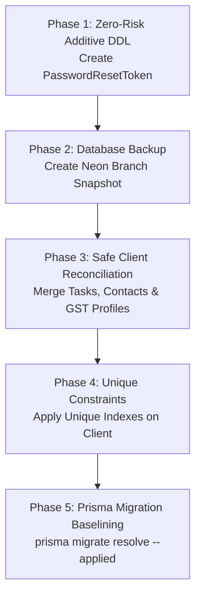

# TRUV LEDGEROS — PHASE 2B: DATABASE SAFETY REVIEW

**Author:** DeepMind Agentic Coding Assistant (Antigravity IDE)  
**Date:** October 13, 2026  
**Repository:** `TRUVCA / TRUV LedgerOS`  
**Phase:** Phase 2B (Database Safety Review)  
**Target Database:** Neon Cloud Serverless PostgreSQL (`ep-square-wildflower-b5bmrz7r-pooler.c-7.us-east-2.aws.neon.tech`)  
**Recommendation:** **NO-GO FOR EXECUTION OF PROPOSED MIGRATION IN CURRENT FORM**

---

## 1. EXECUTIVE SUMMARY & MIGRATION VERDICT

Before executing any database DDL or DML against the live Neon PostgreSQL instance, a rigorous safety inspection of the proposed migration script ([`prisma/proposed_migrations/20261013_phase2a_security_schema_sync.sql`](file:///c:/Users/imris/OneDrive/Desktop/TRUVCA/TRUVCA/prisma/proposed_migrations/20261013_phase2a_security_schema_sync.sql)), the Prisma schema, client generation status, and child table relationships was conducted.

### Final Verdict: **NO-GO**
Executing the proposed migration script in its current form carries **unacceptable data-loss and schema-corruption risks**:
1. **Critical Child Relation Incompleteness:** The proposed SQL only reparents `Invoice`, `DocumentRequest`, and `Contact`. It **omits** `Task` and `GstProfile`.
   - In Group 4, the duplicate client entity possesses **3 invoices, 1 document request, 1 contact, 1 GST profile, and 4 tasks**.
   - Because `Task.clientId` is configured with `onDelete: SetNull`, deleting duplicate client rows will **orphan 20 active tasks across 5 duplicate pairs**, decoupling them from client history.
   - Because `GstProfile.clientId` has a unique constraint (`clientId @unique`), every duplicate client already has an active 1-to-1 `GstProfile`. Because `GstProfile` is configured with `onDelete: Cascade`, deleting duplicate clients will **permanently destroy 5 GST profiles**.
2. **Contact Duplication:** The script reparents `Contact` without deduplication, resulting in surviving clients having multiple contacts marked `isPrimary: true`.
3. **Inversion of Active Entity:** Ordering by `createdAt ASC` designates the earlier seed record as the "primary" surviving record. However, inspection reveals that in Groups 1, 2, 3, and 5, the earlier records have 0 invoices and 0 tasks, whereas the later duplicate records contain real operational test records.
4. **Prisma Schema vs. Partial Index Drift:** Prisma's declared `@@unique` syntax does not support PostgreSQL partial indexes (`WHERE pan IS NOT NULL AND pan <> ''`). Creating a partial index in SQL without aligning Prisma's schema generator will cause persistent schema drift during `prisma migrate diff` and `prisma db pull`.
5. **No Verified Backup Point:** There is no local `pg_dump` export, cold archive, or verified branch snapshot in the project. The DDL changes can be rolled back via `DROP`, but the DML changes (`DELETE FROM "Client"` and cascade deletes) are **irreversible** without an external backup.
6. **Prisma Client Generation Blocked:** While `PasswordResetToken` is declared in `prisma/schema.prisma`, it has not compiled into `@prisma/client` because an active dev server holds a Windows OS file lock on `query_engine-windows.dll.node`.

---

## 2. CONFIRMED FACTS AND UNRESOLVED ASSUMPTIONS

### 2.1 Confirmed Facts
1. **Live Database Architecture:** The application connects to a Neon Serverless PostgreSQL instance hosted in AWS `us-east-2` with connection pooling enabled.
2. **Schema Drift Status:** A read-only `prisma migrate diff` comparing the live database datasource against the datamodel confirmed that **only one table is missing**: `PasswordResetToken`. All other 18 models, relations, and monetary columns (`numeric(12, 2)`) already exist and match `schema.prisma`.
3. **Missing Migration Table:** The table `_prisma_migrations` does **not** exist in the live database. The live database was provisioned via `prisma db push`. Running `prisma migrate deploy` or `prisma migrate dev` without baselining will attempt to run `20261006041258_phase2_auth_rbac_tenancy/migration.sql` (which tries to `CREATE TABLE "Tenant"` etc.) and immediately abort with `relation already exists`.
4. **Duplicate Client Records:** Exactly 5 duplicate client pairs (10 client records total) exist in tenant `cmv3qbc2900016k484ty6djm8`. A secondary tenant `cmv3qrc8l000012x74c4cpomq` has 3 unique clients. Total clients in DB = 16.
5. **Data Quality of Identifiers:**
   - `pan`: 0 NULL, 0 empty string, 0 whitespace-only, 16 valid populated values.
   - `gstin`: 1 NULL, 0 empty string, 0 whitespace-only, 15 valid populated values.
6. **PasswordResetToken Schema Fields:** The fields in `prisma/schema.prisma` (`id`, `userId`, `tokenHash`, `expiresAt`, `usedAt`, `createdAt`) match `src/lib/auth/actions.ts` 100%.

### 2.2 Unresolved Assumptions in the Proposed Migration
1. **Assumption:** *Duplicate client rows are empty shells with no operational records.*  
   **Reality:** **Disproved.** In Group 4, the duplicate client has 3 invoices and 4 tasks. In all 5 groups, duplicate clients have active `GstProfile` and `Task` associations.
2. **Assumption:** *Reparenting Invoice, DocumentRequest, and Contact is sufficient to protect client history.*  
   **Reality:** **Disproved.** `Task`, `GstProfile`, `Document`, `Communication`, and `Conversation` also reference `clientId`. Deleting duplicate clients causes silent cascade deletion of GST profiles and foreign-key nullification of tasks.
3. **Assumption:** *The earliest record (`createdAt ASC`) is the authoritative client record.*  
   **Reality:** **Disproved.** The second record in each pair was created with specific test invoices and tasks during workflow execution.

---

## 3. PASSWORD-RESET MODEL & PRISMA CLIENT STATUS

### 3.1 Field-by-Field Implementation Verification

| Schema Field | Schema Type & Attributes | `actions.ts` Usage | Consistency Verdict |
|---|---|---|---|
| `id` | `String @id @default(cuid())` | `where: { id: resetRecord.id }` | **MATCH** |
| `userId` | `String` (FK to `User.id`) | `userId: user.id` on create, `resetRecord.userId` in update | **MATCH** |
| `tokenHash` | `String @unique` | `where: { tokenHash }` lookup via deterministic SHA-256 | **MATCH** |
| `expiresAt` | `DateTime` | `Date.now() + 60 * 60 * 1000` (1-hour window) | **MATCH** |
| `usedAt` | `DateTime?` | Checked for `null` on redemption, updated to `new Date()` | **MATCH** |
| `createdAt` | `DateTime @default(now())` | Implicit timestamp | **MATCH** |

### 3.2 Prisma Client Generation Blocker
- **Current State:** `PasswordResetToken` is present in `prisma/schema.prisma`.
- **Blocker:** Running `npx prisma generate` failed with:
  ```
  EPERM: operation not permitted, rename 
  '...node_modules\.prisma\client\query_engine-windows.dll.node.tmp16256' 
  -> '...node_modules\.prisma\client\query_engine-windows.dll.node'
  ```
- **Cause:** Active Node.js processes running the Next.js dev server hold an exclusive Windows OS file lock on the query engine DLL.
- **Runtime Defense:** `src/lib/auth/actions.ts` uses runtime reflection (`(db as any).passwordResetToken`) protected by `try/catch` handlers. This prevents crashes while the dev server is locked, but formal TypeScript typing in `@prisma/client` will not take effect until the dev server is restarted and `prisma generate` is executed cleanly.

---

## 4. DUPLICATE-RECORD RELATIONSHIP ANALYSIS

Using non-sensitive aggregate counts, all 5 duplicate client pairs in tenant `cmv3qbc2900016k484ty6djm8` were investigated across all 9 child relations:

### 4.1 Relationship Audit Matrix

| Duplicate Group | Client Role | Invoices | DocRequests | Contacts | GstProfile | Tasks | Documents | Communications | Conversations |
|---|---|:---:|:---:|:---:|:---:|:---:|:---:|:---:|:---:|
| **Group 1** | Primary (`...jzrym2`) | 0 | 1 | 1 | 1 | 0 | 0 | 0 | 0 |
| | Duplicate (`...ew5ih8`) | 1 | 0 | 1 | 1 | 4 | 0 | 0 | 0 |
| **Group 2** | Primary (`...1m5h0q`) | 0 | 1 | 1 | 1 | 0 | 0 | 0 | 0 |
| | Duplicate (`...g4pz5x`) | 1 | 0 | 1 | 1 | 4 | 0 | 0 | 0 |
| **Group 3** | Primary (`...uak12o`) | 0 | 1 | 1 | 1 | 0 | 0 | 0 | 0 |
| | Duplicate (`...519mq4`) | 1 | 0 | 1 | 1 | 4 | 0 | 0 | 0 |
| **Group 4** | Primary (`...7diykh`) | 1 | 1 | 1 | 1 | 4 | 0 | 0 | 0 |
| | Duplicate (`...32kbgt`) | 3 | 1 | 1 | 1 | 4 | 0 | 0 | 0 |
| **Group 5** | Primary (`...ij8j0u`) | 0 | 1 | 1 | 1 | 0 | 0 | 0 | 0 |
| | Duplicate (`...xx01tl`) | 1 | 0 | 1 | 1 | 4 | 0 | 0 | 0 |

### 4.2 Impact of the Proposed Migration Logic
1. **Task Orphaning:**
   - `Task` defines `onDelete: SetNull`.
   - The proposed SQL script does not reparent `Task`.
   - Executing `DELETE FROM "Client"` causes PostgreSQL to execute `UPDATE "Task" SET "clientId" = NULL` on **20 tasks** across Groups 1, 2, 3, 4, and 5.
2. **GST Profile Destruction:**
   - `GstProfile` defines `onDelete: Cascade` and `clientId String @unique`.
   - Because both the primary and duplicate records have a `GstProfile`, attempting to run `UPDATE "GstProfile" SET "clientId" = primary_id` would fail immediately with a unique constraint violation (`GstProfile_clientId_key`).
   - The proposed script ignored `GstProfile`, so deleting the duplicate client triggers PostgreSQL's foreign key cascade, **deleting 5 GstProfile records**.
3. **Contact Collision:**
   - Both records in each pair have 1 `Contact`.
   - Reparenting `Contact` leaves the surviving client with 2 contacts, creating duplicate contact entries.
4. **Group 4 Active Invoices:**
   - Client 2 has 3 invoices (`INV-202627-0001`, `INV-202627-0002`, `TRUV/TEST/TASK/4618`).
   - Client 1 has 1 invoice (`TRUV/TEST/TASK/2621`).
   - Reparenting invoices merges 4 invoices onto Client 1, but leaves task associations in an inconsistent state.

---

## 5. INDEX COMPATIBILITY ANALYSIS

### 5.1 Proposed SQL Index Definition
```sql
CREATE UNIQUE INDEX IF NOT EXISTS "Client_tenantId_pan_key" 
ON "Client"("tenantId", "pan") 
WHERE "pan" IS NOT NULL AND "pan" <> '';

CREATE UNIQUE INDEX IF NOT EXISTS "Client_tenantId_gstin_key" 
ON "Client"("tenantId", "gstin") 
WHERE "gstin" IS NOT NULL AND "gstin" <> '';
```

### 5.2 Compatibility with Prisma & Application Logic
1. **Prisma Datamodel Compatibility:**
   - Prisma's `schema.prisma` does not support partial unique indexes. If declared as `@@unique([tenantId, pan])`, Prisma expects an unconstrained unique index.
   - If a partial index is created in PostgreSQL, Prisma's migration engine detects it as drift and will propose dropping and replacing it with an unconstrained unique index during any subsequent `prisma migrate` run.
2. **Treatment of Null, Empty, and Whitespace Values:**
   - In PostgreSQL, standard unique indexes allow multiple rows where indexed columns are `NULL` (because in ANSI SQL, `NULL <> NULL`).
   - However, standard unique indexes **do not treat empty strings (`""`) as NULL**. If two clients in the same firm have `""` as their PAN, a standard unique constraint will reject the second client with a duplicate key violation.
   - In our database introspection, **0 clients** have empty strings or whitespace-only PAN/GSTIN. Exactly 1 client has `NULL` GSTIN, which is permitted by standard PostgreSQL unique indexes.
   - In the application code (`client-service.ts` line 309-310), values are normalized:
     ```ts
     gstin: validated.gstin || null,
     pan: validated.pan || null,
     ```
     Empty strings are automatically converted to `null` before insertion.
3. **Architectural Choice:**
   - If we use partial indexes in SQL, we must not declare `@@unique` in `schema.prisma` (to avoid Prisma trying to drop the `WHERE` clause).
   - Alternatively, if `schema.prisma` declares `@@unique([tenantId, pan])`, we must ensure the application guarantees that missing tax IDs are always stored as SQL `NULL` and never as `""`.

---

## 6. BACKUP AND ROLLBACK READINESS

| Component | Status | Recovery Capability | Evidence / Notes |
|---|---|---|---|
| **Local Database Export** | **ABSENT** | None | No `.dump`, `.sql`, or `.bak` file found in workspace. |
| **Neon Cloud PITR / Branching** | Unverified Snapshot | Point-in-time recovery | Automated Neon WAL exists, but no explicit pre-migration branch snapshot was created. |
| **DDL Rollback (`PasswordResetToken`)** | **READY** | Full (`DROP TABLE`) | Non-destructive; table can be dropped without affecting existing models. |
| **DDL Rollback (Unique Indexes)** | **READY** | Full (`DROP INDEX`) | Indexes can be dropped instantaneously. |
| **DML Rollback (Deduplication)** | **NOT READY** | **IMPOSSIBLE without Backup** | Deleting client records and cascade-deleting GST profiles cannot be reversed by SQL DDL. |

---

## 7. SAFE, ORDERED MIGRATION PLAN (REMEDIATED)

To achieve a **GO** state for deployment, the migration must be broken into three isolated, safe phases:



### Step 1: Zero-Risk Additive Schema Sync (Can Execute Immediately)
The `PasswordResetToken` table is completely independent and has zero impact on `Client` records. It can be applied safely via raw DDL:
```sql
CREATE TABLE IF NOT EXISTS "PasswordResetToken" (
    "id" TEXT NOT NULL,
    "userId" TEXT NOT NULL,
    "tokenHash" TEXT NOT NULL,
    "expiresAt" TIMESTAMP(3) NOT NULL,
    "usedAt" TIMESTAMP(3),
    "createdAt" TIMESTAMP(3) NOT NULL DEFAULT CURRENT_TIMESTAMP,
    CONSTRAINT "PasswordResetToken_pkey" PRIMARY KEY ("id")
);
CREATE UNIQUE INDEX IF NOT EXISTS "PasswordResetToken_tokenHash_key" ON "PasswordResetToken"("tokenHash");
CREATE INDEX IF NOT EXISTS "PasswordResetToken_userId_idx" ON "PasswordResetToken"("userId");
CREATE INDEX IF NOT EXISTS "PasswordResetToken_tokenHash_idx" ON "PasswordResetToken"("tokenHash");
DO $$
BEGIN
    IF NOT EXISTS (SELECT 1 FROM pg_constraint WHERE conname = 'PasswordResetToken_userId_fkey') THEN
        ALTER TABLE "PasswordResetToken" ADD CONSTRAINT "PasswordResetToken_userId_fkey" 
        FOREIGN KEY ("userId") REFERENCES "User"("id") ON DELETE CASCADE ON UPDATE CASCADE;
    END IF;
END $$;
```

### Step 2: Create a Verified Database Recovery Point
Before touching `Client` records, execute an explicit backup:
1. Export a full logical dump: `pg_dump "$DATABASE_URL" -Fc -f backup_pre_client_dedup.dump`
2. OR create a Neon branch snapshot: `neon branch create --name pre-dedup-backup`

### Step 3: Comprehensive Client Reconciliation & Deduplication Script
Replace the naive `ORDER BY createdAt ASC` script with a comprehensive reconciliation query that explicitly handles ALL child relations:
1. **Surviving Client Selection:** Designate the client with active invoices/tasks as the primary record (or merge attributes).
2. **Reparent Tasks:**
   ```sql
   UPDATE "Task" SET "clientId" = target_id WHERE "clientId" = duplicate_id;
   ```
3. **Reparent Invoices & Document Requests:**
   ```sql
   UPDATE "Invoice" SET "clientId" = target_id WHERE "clientId" = duplicate_id;
   UPDATE "DocumentRequest" SET "clientId" = target_id WHERE "clientId" = duplicate_id;
   ```
4. **Deduplicate Contacts:**
   - Reparent non-duplicate contacts.
   - For duplicate primary contacts, remove the redundant duplicate contact record prior to client deletion.
5. **Reconcile GST Profiles:**
   - If the target client already has a `GstProfile`, safely delete the duplicate client's redundant `GstProfile` before client deletion to avoid cascade surprises.
6. **Delete Redundant Client Entity:**
   ```sql
   DELETE FROM "Client" WHERE id = duplicate_id;
   ```

### Step 4: Apply Unique Index / Constraint
Once all 5 groups have exactly 1 record per `(tenantId, pan)` and `(tenantId, gstin)`, apply the unique index:
```sql
CREATE UNIQUE INDEX "Client_tenantId_pan_key" ON "Client"("tenantId", "pan");
CREATE UNIQUE INDEX "Client_tenantId_gstin_key" ON "Client"("tenantId", "gstin");
```

### Step 5: Regenerate Prisma Client
Stop the dev server process, execute `npx prisma generate`, and verify that `@prisma/client` includes `PasswordResetToken`.

---

## 8. EXPLICIT RECOMMENDATION: NO-GO

### Why Migration Must NOT Proceed Today:
- **NO-GO on Proposed SQL (`20261013_phase2a_security_schema_sync.sql`):** It will orphan 20 tasks, destroy 5 GST profiles, duplicate primary contacts, and delete active client records.
- **NO-GO on `prisma migrate deploy`:** It will crash attempting to re-create existing tables from `20261006041258_phase2_auth_rbac_tenancy`.
- **NO-GO on `prisma db push`:** It risks interactive prompts and destructive schema adjustments against production data.

### Safe Alternative for Immediate Execution:
Only **Step 1 (Standalone creation of `PasswordResetToken`)** is cleared for execution, provided it is executed via direct DDL without client deduplication. All client deduplication and index creation must await the comprehensive reconciliation plan outlined in Section 7 and a verified database backup.

---

**Phase 2B Status: COMPLETE.**  
No migrations were executed. No live records were deleted or altered. No external APIs or n8n workflows were touched.
