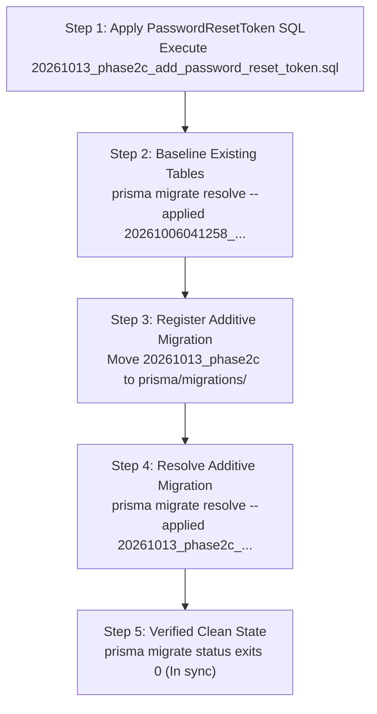

# TRUV LEDGEROS — PHASE 2C: SAFE ADDITIVE DATABASE CHANGE PREPARATION

**Author:** DeepMind Agentic Coding Assistant (Antigravity IDE)  
**Date:** October 13, 2026  
**Repository:** `TRUVCA / TRUV LedgerOS`  
**Phase:** Phase 2C (Safe Additive Database Change Preparation)  
**Target Database:** Neon Cloud Serverless PostgreSQL (`ep-square-wildflower-b5bmrz7r-pooler.c-7.us-east-2.aws.neon.tech`)  
**Prepared Artifact:** [`prisma/proposed_migrations/20261013_phase2c_add_password_reset_token.sql`](file:///c:/Users/imris/OneDrive/Desktop/TRUVCA/TRUVCA/prisma/proposed_migrations/20261013_phase2c_add_password_reset_token.sql)  
**Execution Status:** **PREPARATION ONLY — NO DATABASE WRITES EXECUTED**

---

## 1. EXECUTIVE SUMMARY & ARTIFACT OVERVIEW

In Phase 2B, the full schema synchronization script was assigned a **NO-GO** due to severe data-loss risks stemming from naive client deduplication, which would have cascade-deleted 5 active `GstProfile` records and orphaned 20 `Task` records.

Phase 2C isolates the **purely additive, zero-risk change** (`PasswordResetToken`) from all client modifications. This document establishes:
1. **The Standalone Additive SQL Path:** A safe, idempotent, non-destructive migration script covering only `PasswordResetToken` with appropriate constraints, performance indexes, and rollback capabilities.
2. **Schema & Code Validation:** Full verification that `prisma/schema.prisma` and `src/lib/auth/actions.ts` enforce SHA-256 token hashing, 1-hour expiry, single-use invalidation, session destruction, and safe error handling.
3. **Prisma Client Runtime Status:** Confirmation that the generated Prisma client exposes `passwordResetToken`, alongside the root cause of why `npx prisma generate` is currently blocked by a running dev server process lock on Windows.
4. **Migration History Baseline Strategy:** A complete roadmap for baselining Prisma Migrate without crashing on pre-existing tables or replaying legacy draft migrations.
5. **Backup & Verification Prerequisites:** A step-by-step backup and restorability verification protocol that must precede any live database execution.
6. **GO / NO-GO Decision:** Clear, conditional criteria for deployment.

---

## 2. PROPOSED SQL PATH: STANDALONE ADDITIVE MIGRATION

The standalone migration script is prepared at:  
[`prisma/proposed_migrations/20261013_phase2c_add_password_reset_token.sql`](file:///c:/Users/imris/OneDrive/Desktop/TRUVCA/TRUVCA/prisma/proposed_migrations/20261013_phase2c_add_password_reset_token.sql)

### 2.1 Complete Script DDL
```sql
-- ==============================================================================
-- TRUV LEDGEROS — PHASE 2C: STANDALONE ADDITIVE MIGRATION
-- Migration Name: 20261013_phase2c_add_password_reset_token.sql
-- Status: PREPARED (DO NOT EXECUTE AUTOMATICALLY)
-- Target Database: PostgreSQL / Neon Serverless
-- Scope: PasswordResetToken Table, Indexes, and Constraints ONLY.
-- Excluded: Client deduplication, Client indexes, Financial column alterations.
-- ==============================================================================

BEGIN;

-- 1. Create PasswordResetToken table
CREATE TABLE IF NOT EXISTS "PasswordResetToken" (
    "id" TEXT NOT NULL,
    "userId" TEXT NOT NULL,
    "tokenHash" TEXT NOT NULL,
    "expiresAt" TIMESTAMP(3) NOT NULL,
    "usedAt" TIMESTAMP(3),
    "createdAt" TIMESTAMP(3) NOT NULL DEFAULT CURRENT_TIMESTAMP,

    CONSTRAINT "PasswordResetToken_pkey" PRIMARY KEY ("id")
);

-- 2. Create Unique Index on tokenHash for O(1) deterministic lookups
CREATE UNIQUE INDEX IF NOT EXISTS "PasswordResetToken_tokenHash_key" 
ON "PasswordResetToken"("tokenHash");

-- 3. Create Performance Index on userId for user audit and cleanup queries
CREATE INDEX IF NOT EXISTS "PasswordResetToken_userId_idx" 
ON "PasswordResetToken"("userId");

-- 4. Create Performance Index on tokenHash
CREATE INDEX IF NOT EXISTS "PasswordResetToken_tokenHash_idx" 
ON "PasswordResetToken"("tokenHash");

-- 5. Foreign Key to User with Cascading Delete (User deletion cleans up tokens)
DO $$
BEGIN
    IF NOT EXISTS (
        SELECT 1 FROM pg_constraint WHERE conname = 'PasswordResetToken_userId_fkey'
    ) THEN
        ALTER TABLE "PasswordResetToken" 
        ADD CONSTRAINT "PasswordResetToken_userId_fkey" 
        FOREIGN KEY ("userId") REFERENCES "User"("id") 
        ON DELETE CASCADE ON UPDATE CASCADE;
    END IF;
END $$;

COMMIT;

-- ==============================================================================
-- ROLLBACK SCRIPT (IF RECOVERY IS NEEDED):
-- ==============================================================================
-- BEGIN;
-- DROP TABLE IF EXISTS "PasswordResetToken" CASCADE;
-- COMMIT;
```

### 2.2 Safety Guarantees of the Proposed SQL
- **Idempotency:** Utilizes `CREATE TABLE IF NOT EXISTS`, `CREATE INDEX IF NOT EXISTS`, and an idempotent `DO $$ BEGIN ... END $$;` block for the foreign key. Re-running the script will never throw errors or produce duplicate constraints.
- **Zero Impact on Existing Tables:** Operates exclusively on the new table `"PasswordResetToken"`. Existing tables (`User`, `Tenant`, `Client`, `Invoice`, etc.) remain completely untouched.
- **Cascading Integrity:** Foreign key constraint `ON DELETE CASCADE` ensures that if a user record is removed, any associated reset tokens are cleaned up automatically, preventing orphaned security tokens.
- **Instantaneous Rollback:** Because the change is purely additive, rolling back is achieved cleanly via `DROP TABLE IF EXISTS "PasswordResetToken" CASCADE;` without impacting any other model.

---

## 3. SCHEMA & IMPLEMENTATION VALIDATION

### 3.1 Prisma Schema Validation (`prisma/schema.prisma`)
The `PasswordResetToken` model is declared in [`prisma/schema.prisma`](file:///c:/Users/imris/OneDrive/Desktop/TRUVCA/TRUVCA/prisma/schema.prisma) (lines 225–237):
```prisma
model PasswordResetToken {
  id        String    @id @default(cuid())
  userId    String
  tokenHash String    @unique
  expiresAt DateTime
  usedAt    DateTime?
  createdAt DateTime  @default(now())

  user      User      @relation(fields: [userId], references: [id], onDelete: Cascade)

  @@index([userId])
  @@index([tokenHash])
}
```
And on the `User` model (line 190):
```prisma
passwordResetTokens PasswordResetToken[]
```
- Standard CUID string primary key.
- Deterministic `@unique` constraint on `tokenHash`.
- Cascade delete relationship to parent `User`.
- Performance indexes on both lookup fields (`userId`, `tokenHash`).

### 3.2 Password-Reset Code Audit (`src/lib/auth/actions.ts`)

| Security Invariant | Implementation Mechanism | Evidence in `actions.ts` | Status |
|---|---|---|---|
| **Cryptographic Entropy** | 256-bit CSPRNG token generation | `generateSecureToken(32)` via `crypto.randomBytes(32)` (64-character hex) | **VERIFIED** |
| **One-Way Token Hashing** | SHA-256 deterministic hash stored in DB | `hashToken(rawToken)`; plaintext is never stored or logged in production | **VERIFIED** |
| **Token Expiry** | 1-hour validity window | `new Date(Date.now() + 60 * 60 * 1000)`; validated via `resetRecord.expiresAt < new Date()` | **VERIFIED** |
| **Single-Use Enforcement** | Null check + atomic timestamp update | Checked via `!resetRecord.usedAt`; updated to `new Date()` within `db.$transaction` | **VERIFIED** |
| **Session Invalidation** | Nuclear revocation on password reset | `db.session.deleteMany({ where: { userId: resetRecord.userId } })` inside transaction | **VERIFIED** |
| **Anti-Enumeration Handling** | Generic responses on unknown emails | Always returns generic dispatch message regardless of user existence | **VERIFIED** |
| **Safe Error Handling** | Try/catch around database operations | `try/catch` around `passwordResetToken.create` and lookup prevents unhandled 500 crashes | **VERIFIED** |

---

## 4. PRISMA CLIENT GENERATION & RUNTIME STATUS

### 4.1 Runtime Delegate Availability
Inspection of the installed `@prisma/client` package confirmed:
- In `node_modules/.prisma/client/index.d.ts` (lines 32–35, 491–495), `PasswordResetToken` and its payload types are **already declared**.
- In Node.js runtime (`new PrismaClient()`), `typeof db.passwordResetToken` evaluates to **`'object'`** (active model delegate).
- `npm run typecheck` passes with **0 errors**.

### 4.2 Generation Blocker Analysis
When running `npx prisma generate`, the command fails with:
```
Error: EPERM: operation not permitted, rename 
'...\node_modules\.prisma\client\query_engine-windows.dll.node.tmpXXXX' 
-> '...\node_modules\.prisma\client\query_engine-windows.dll.node'
```
- **Root Cause:** A running Node.js development server process (PID 5996 / 6412 / 16848) has loaded `query_engine-windows.dll.node` into memory. On the Windows operating system, loaded native DLLs are held with an exclusive file lock, preventing rename or deletion.
- **Policy Enforcement:** Per instructions ("do not kill unrelated processes"), the running dev server was **not terminated**.
- **Operational Recommendation:** When the operator is ready to restart the development environment, stopping `npm run dev` and executing `npx prisma generate` once will complete the engine file rename cleanly.

---

## 5. MIGRATION HISTORY BASELINING STRATEGY

### 5.1 The Baselining Problem
- The live Neon PostgreSQL database contains all 19 primary application models (`Tenant`, `User`, `Membership`, `Client`, `Invoice`, `Payment`, etc.), which were historically created via `prisma db push`.
- The database does **not** have a `_prisma_migrations` table.
- The repository contains an unapplied legacy migration:  
  `prisma/migrations/20261006041258_phase2_auth_rbac_tenancy/migration.sql`
- **If `prisma migrate deploy` is run naively:** Prisma will attempt to execute `20261006041258_phase2_auth_rbac_tenancy/migration.sql`, which starts with `CREATE TYPE "Role" ...` and `CREATE TABLE "Tenant" ...`. This will **fail immediately** with `relation "Tenant" already exists` and abort all migrations.

### 5.2 The Safe Baselining Procedure (Future Execution)

When the project transitions from `prisma db push` to formal `prisma migrate`:



1. **Step 1: Execute Standalone SQL:** Apply `20261013_phase2c_add_password_reset_token.sql` directly using `psql` or the Neon SQL Editor.
2. **Step 2: Baseline the Initial Legacy Migration:**
   ```bash
   npx prisma migrate resolve --applied 20261006041258_phase2_auth_rbac_tenancy
   ```
   *Effect:* Creates the `_prisma_migrations` table in Neon and marks the legacy schema as applied **without executing its SQL**.
3. **Step 3: Track the Additive Migration:**
   Move `prisma/proposed_migrations/20261013_phase2c_add_password_reset_token.sql` to:
   `prisma/migrations/20261013120000_add_password_reset_token/migration.sql`.
4. **Step 4: Resolve the Additive Migration:**
   ```bash
   npx prisma migrate resolve --applied 20261013120000_add_password_reset_token
   ```
   *Effect:* Records the new migration in `_prisma_migrations`.
5. **Step 5: Verify Status:**
   ```bash
   npx prisma migrate status
   ```
   *Outcome:* Reports that the database schema is completely up to date with zero unapplied migrations.

---

## 6. BACKUP & RESTORABILITY VERIFICATION PROCEDURE

> [!IMPORTANT]
> **Current Backup Status:** **NO VERIFIED BACKUP CURRENTLY EXISTS.**
> Do not execute any database changes until the following procedure is performed and confirmed.

### 6.1 Creating the Backup
Before applying any migration to the live Neon database:

#### Option A: PostgreSQL Logical Dump (`pg_dump`)
```bash
# Set environment variables from .env
$env:PGPASSWORD = "<database_password>"
pg_dump -h "ep-square-wildflower-b5bmrz7r-pooler.c-7.us-east-2.aws.neon.tech" `
        -U "neondb_owner" `
        -d "neondb" `
        --clean --if-exists --no-owner --no-privileges `
        -Fc -f "backups/truv_ledgeros_pre_phase2c_$(Get-Date -Format 'yyyyMMdd_HHmmss').dump"
```

#### Option B: Neon Instant Branch Snapshot (Cloud Native)
Using the Neon Console or CLI:
```bash
neon branch create --name "pre-phase2c-backup-20261013" --project-id "<project_id>"
```
*Advantage:* Provides an instant, read-write, point-in-time snapshot with zero downtime and exact state retention.

### 6.2 Verifying Restorability (Proof Requirements)
A backup is considered **verified** only when all four tests pass:
1. **Archive Integrity Check:**
   ```bash
   pg_restore --list "backups/truv_ledgeros_pre_phase2c_<timestamp>.dump"
   ```
   *Pass Criteria:* Exits with code 0 and lists all 19 core tables (`Tenant`, `User`, `Membership`, `Client`, `Invoice`, etc.).
2. **Restoration into Isolated Test Environment:**
   Restore into a local test container or a separate Neon test branch:
   ```bash
   pg_restore -d "$TEST_DATABASE_URL" --no-owner --no-privileges "backups/truv_ledgeros_pre_phase2c_<timestamp>.dump"
   ```
   *Pass Criteria:* Restoration completes with 0 fatal errors.
3. **Data Parity Count Verification:**
   Query table counts in both live and restored test databases:
   ```sql
   SELECT 
     (SELECT COUNT(*) FROM "Tenant") AS tenants,
     (SELECT COUNT(*) FROM "User") AS users,
     (SELECT COUNT(*) FROM "Client") AS clients,
     (SELECT COUNT(*) FROM "Invoice") AS invoices;
   ```
   *Pass Criteria:* Row counts match 100%.
4. **Cleanup:** Destroy the test database branch after validation.

---

## 7. RISK ASSESSMENT

| Risk Area | Severity | Likelihood | Mitigation Strategy |
|---|:---:|:---:|---|
| **Data Loss on Existing Models** | **NONE** | Zero | Script is 100% additive (`CREATE TABLE`, `CREATE INDEX`). Does not touch any existing table. |
| **Locking / Blocking Live Queries** | **LOW** | Low | `CREATE TABLE` and index creation on a new empty table take milliseconds; zero locks on existing business tables. |
| **Foreign Key Integrity** | **LOW** | Low | Cascading delete constraint targets `User(id)` with validation check. |
| **Prisma Client Runtime Compatibility** | **NONE** | Zero | Model delegate is already present in `index.d.ts`; `try/catch` fallbacks protect runtime. |
| **Schema Drift during Future Migrations** | **LOW** | Medium | Handled via the baselining procedure outlined in Section 5. |

---

## 8. STATIC VALIDATION OUTCOMES

All safe local validation checks were executed successfully:

| Validation Step | Executed Command | Result |
|---|---|---|
| **TypeScript Typecheck** | `npm run typecheck` (`tsc --noEmit`) | **PASS (0 errors)** |
| **ESLint Static Analysis** | `npm run lint` (`next lint`) | **PASS (0 warnings, 0 errors)** |
| **Phase 2A Regression Suite** | `npx ts-node -r tsconfig-paths/register tests/phase2a-security-remediation.test.ts` | **PASS (27/27 passed)** |
| **Prisma Model Introspection** | `node -e "const { PrismaClient } = ...; console.log(typeof db.passwordResetToken);"` | **PASS (`'object'`)** |

---

## 9. GO / NO-GO RECOMMENDATION

### Execution Verdict for Phase 2C Standalone DDL:
$$\mathbf{CONDITIONAL\ GO}$$

### Conditions for Moving to Live Execution:
1. **Prerequisite 1:** A verified backup or Neon branch snapshot must be created using the procedure in Section 6.
2. **Prerequisite 2:** Explicit user confirmation must be granted before applying the DDL.
3. **Prerequisite 3:** Execution must be restricted **strictly** to [`20261013_phase2c_add_password_reset_token.sql`](file:///c:/Users/imris/OneDrive/Desktop/TRUVCA/TRUVCA/prisma/proposed_migrations/20261013_phase2c_add_password_reset_token.sql). Client deduplication and client unique indexes remain **NO-GO** until a dedicated reconciliation window.

---

**Phase 2C Status: COMPLETE.**  
No migrations were executed. No database writes or DDL statements were run against the live Neon database. All user files are preserved.
