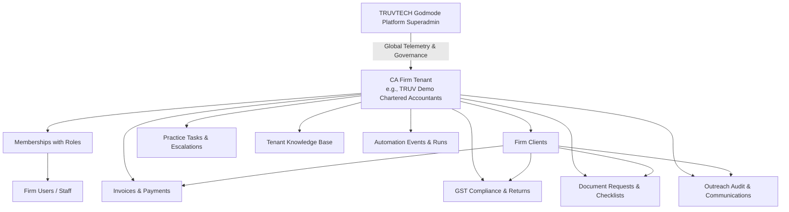

# TRUV LedgerOS — Production System Architecture

## 1. System Overview & Core Tenets

**TRUV LedgerOS** is a multi-tenant, cloud-native AI-powered practice operating system designed specifically for Indian Chartered Accountants (CAs), tax advocates, and compliance consultants.

### Guiding Principles
* **Single Codebase, Multi-Tenant Database**: 1 Codebase + 1 PostgreSQL Database + Multiple Tenants.
* **Zero-Trust Client Tenancy**: Never accept or trust `tenantId` from client-side requests. `tenantId` is always resolved server-side from the authenticated user's active membership.
* **Server-First Components**: Utilize React Server Components (RSC) for data fetching, reducing client JavaScript bundle sizes and preventing data leakage.
* **Strict Role-Based Access Control (RBAC)**: 7 granular practice roles enforce principle of least privilege.
* **Idempotent Automation Bus**: All n8n automation events pass through a centralized, retry-safe `automation_events` table with unique idempotency keys and HMAC-SHA256 signatures.

---

## 2. Multi-Tenant Data & Security Hierarchy

---

## 3. Database Models Summary (25 Models)

| Category | Models | Purpose |
|---|---|---|
| **Tenancy & Auth** | `Tenant`, `User`, `Membership` | Multi-tenant organization boundaries, user accounts, and role memberships. |
| **Client Management** | `Client`, `Contact` | Client master, 15-char GSTINs, primary and secondary contacts. |
| **Finance & Billing** | `Invoice`, `InvoiceItem`, `Payment` | Sequential GST billing, partner approval thresholds, and payment tracking. |
| **GST Compliance** | `GstProfile`, `GstReturn` | Filing calendar, return statuses, and net liability calculations. |
| **Documents** | `DocumentRequest`, `Document` | Checklists, upload verification, and reminder sequences. |
| **Tasks & Escalations** | `Task` | Operational hub for partner approvals, calls, and AI handoffs. |
| **Communications** | `Communication`, `Conversation`, `Message` | Audit log of email, WhatsApp, voice calls, and multi-channel chat threads. |
| **AI & Automation** | `KnowledgeBase`, `Automation`, `AutomationRun`, `AutomationEvent` | Custom QA knowledge, 5-suite automation triggers, and signed n8n webhooks. |
| **SaaS & Platform** | `Subscription`, `UsageRecord`, `Integration`, `AuditLog`, `Notification` | Quota enforcement, metered telemetry, encrypted API vault, and audit logs. |

---

## 4. Multi-Tenant Query Indexing Strategy

To guarantee millisecond query performance across thousands of tenants, the schema employs strategic compound indexes:
* `[tenantId, status]`: Accelerates status filtering for invoices, tasks, GST returns, and document requests.
* `[tenantId, clientId]`: Powers instant Client 360 unified timeline aggregation.
* `[tenantId, dueDate]`: Enables daily 10:00 AM overdue checks and upcoming tax deadline alerts.
* `[tenantId, createdAt]`: Optimizes paginated activity feeds and communication logs.
* `[idempotencyKey]`: Enforces absolute idempotency across webhook deliveries.
